# London Mystery — User Flow V2 (Guest-first + Parent Account)

> **⛔ 폐기된 방향 (2026-10-16):** 사용자 계정·Firebase·클라우드 동기화 방향은 최종 폐기되었다. London Mystery는 **기기당 탐정 1명, 100% 오프라인** 게임이다. 현재 설계는 `docs/OFFLINE_SINGLE_DETECTIVE.md`. 이 문서의 계정·프로필·동기화·보호자 계정 관련 내용은 더 이상 유효하지 않으며 기록으로만 남긴다.

> **문서 상태:** 소스 대조 완료(2026-10-13) · **D3 = B안(게스트 우선 + 선택적 부모 계정 연결) 확정** · 구현 승인 전
> **기준:** 실제 저장소 대조 결과. 부록 A(V1)는 기존 게임 내부 흐름 기준선.
> **표기:** `[CURRENT]` 소스에서 확인된 기존 구현 · `[PLANNED]` 신규 개발 예정 · `[DECISION]` 확정 · `[OPEN]` 결정 필요
> **⚠ 정책 변경 (2026-10-13):** 부모 계정 + 자녀 프로필 구조는 폐기하고 **일반 사용자 계정 + 탐정 프로필** 구조로 변경했다. 흐름: 앱 실행 → 로그인/회원가입/게스트 → 탐정 이름·프로필 → Season 1 → 저장·계정 연동. 게스트 플레이는 유지. 이 문서의 "부모/보호자 계정", "자녀 프로필"은 각각 "사용자 계정", "탐정 프로필"로 읽는다. 단, **한국 만 14세 미만 사용자의 개인정보 처리와 법정대리인 동의 의무는 별개로 유효**하며, 동의 절차가 확정되기 전에는 개인정보 클라우드 업로드를 차단한다(이메일 인증 ≠ 법정대리인 동의). 코드 명칭: `AuthService`, `UserSession`, `FirebaseAuthService`, `FakeAuthService`, `ConsentRepository`.

## 1. 개요

**핵심 변화:** 회원가입은 필수가 아니다. 최초 실행 시 언어/지역을 고른 뒤 **게스트 체험** 또는 **부모 계정 연결**을 선택한다. 게스트는 바로 기존 탐정 등록 → Season 1으로 들어간다. 보호자는 나중에 언제든 계정을 만들고 게스트 기록을 자녀 프로필에 연결할 수 있다. 기존 Season 1 게임 루프는 그대로다.

**현재 구현 [CURRENT]:** Title → (신규) 탐정 등록 / (기존) CONTINUE ADVENTURE. 계정·프로필·언어 선택 없음, 기기 전역 저장.

## 2. 통합 진입 플로우 [PLANNED]

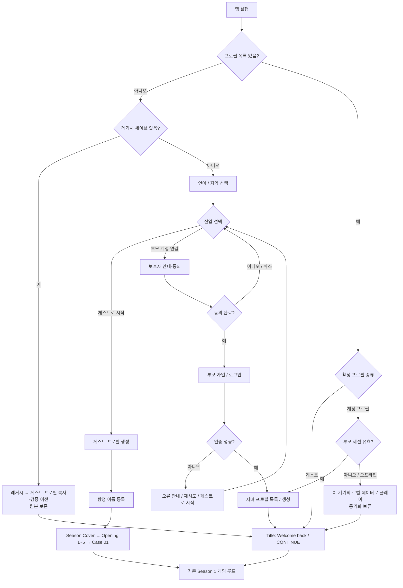

> Phase 1에서는 언어/지역·진입 선택 화면 없이, 레거시 이전 + 게스트 프로필 자동 생성만 들어간다(사용자 화면 변화 없음). 화면은 Phase 3에서 추가한다.
> 부모 세션 만료 시 로컬 플레이를 허용할지, 프로필 목록을 보호자 인증 뒤에 둘지는 [OPEN].

## 3. 게스트 → 자녀 프로필 연결 [PLANNED]

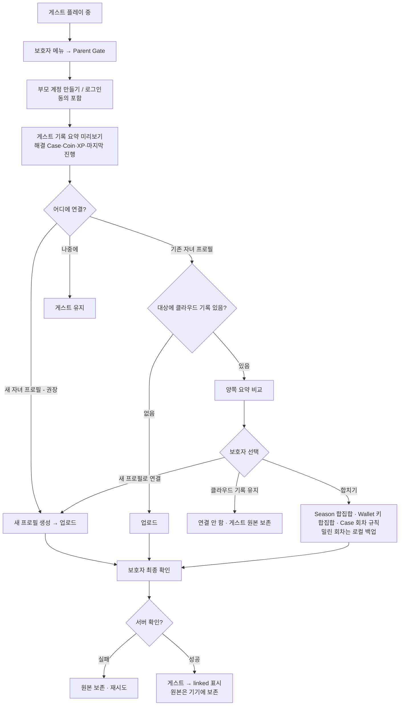

## 4. 자녀 프로필 관리 [PLANNED]

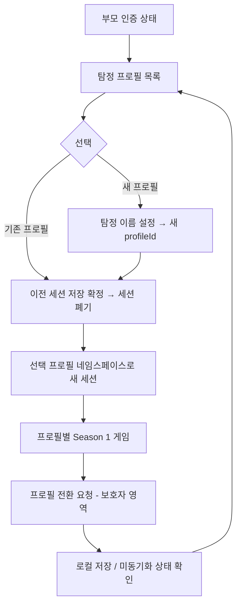

**원칙:** 전환만으로 다른 아이의 XP·Coin·힌트·Notebook·Evidence가 보이거나 섞이지 않는다. 일회성 권한(Parent Report 패스, Operator 스위치)도 세션과 함께 사라진다. 추가·삭제·전환은 보호자 영역에서만.

## 5. 기존 게임 내부 플로우 [CURRENT — 변경 없음]

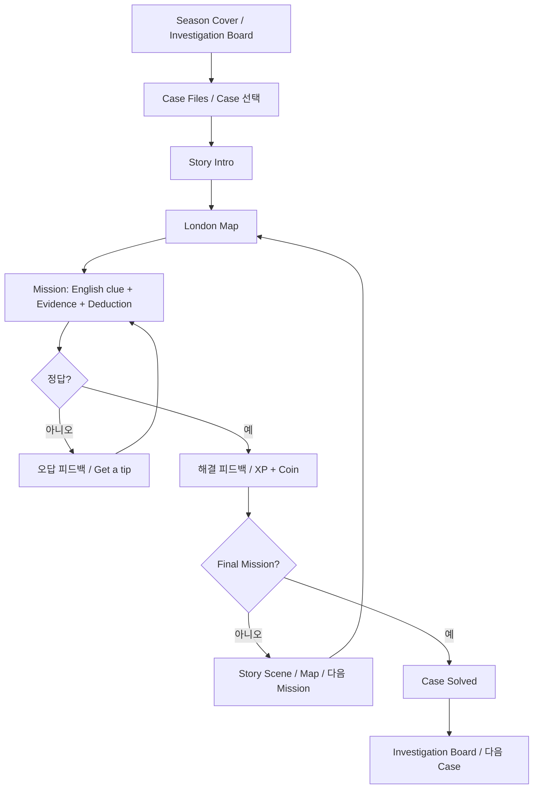

## 6. GET A TIP [CURRENT — 변경 없음]

Mission / 오답 시트 / Final → 중앙 확인 Dialog(`YOUR TOTAL COINS`, `Reveal a tip?`, `FREE`·`20 Coins`, `CANCEL`·`REVEAL`). TIP 1 무료, TIP 2 20 Coins, 부족 시 무료 도움, 소유한 Tip 재열람 무료. 상세는 부록 A §5.

## 7. 저장·동기화 플로우

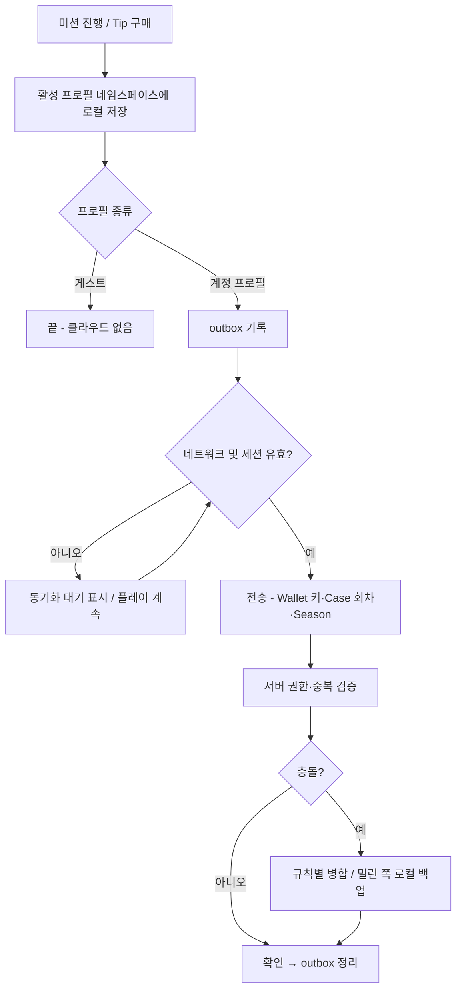

## 8. 보호자 흐름

- `[CURRENT]` Parent Gate(곱셈 퀴즈) → Parent Report / Game Master. 법적 동의·부모 인증이 아님.
- `[PLANNED]` 보호자 메뉴 → 계정 만들기/로그인(동의 포함) → 게스트 연결, 자녀 프로필 관리, 계정 설정·탈퇴.
- `[OPEN]` Parent Report 클라우드 저장 범위와 열람 권한.

## 9. 오류·예외 UX

| 상황 | 처리 |
|---|---|
| 레거시 이전 중 종료 | 다음 실행 시 처음부터 재이전, 원본 보존 |
| 레거시 이전 검증 실패 | 레거시 키로 게임을 계속할 수 있는 안전 모드 + 진단 기록 [OPEN] |
| 동의 거부·취소 | 진입 선택 / 게스트 플레이로 복귀 |
| 로그인 실패 | 오류 안내, 재시도, 게스트로 계속 |
| 서버 연결 실패 | 계정 프로필은 로컬 플레이 지속, 동기화 보류 |
| 프로필 전환 중 미동기화 | 로컬 저장 확인 후 전환, 유실 경고 없이 강제 전환 금지 |
| 게스트 연결 대상에 클라우드 기록 존재 | 자동 덮어쓰기 금지, 비교·선택 |
| Coin 거래 재시도 | 같은 키로 중복 차감/지급 방지 |
| 새 모험 시작 | 현재 프로필만 초기화, 계정 프로필은 보호자 확인 |

## 10. 수동 QA 여정

1. 레거시 세이브가 있는 기기 업데이트 → Welcome back 동일, Coin·XP·힌트 동일.
2. 새 기기 → 게스트로 시작 → Case 01 → 앱 재시작 후 복원.
3. 게스트 플레이 → 부모 가입 → 새 자녀 프로필로 연결 → 다른 기기에서 로그인해 복원.
4. 게스트 기록을 이미 클라우드 기록이 있는 프로필에 연결 → 비교 화면 → 각 선택지 결과 확인.
5. 동일 부모 아래 A/B 프로필 → 각기 다른 미션 → 잔액·진행 독립.
6. Play Again 후 다른 기기와 동기화 → 지운 기록이 되살아나지 않음.
7. 네트워크 차단 → 미션 완료·TIP 구매 → 재연결 → 한 번만 반영.
8. 동의 취소, 인증 실패, 계정 전환, 프로필 삭제.
9. TIP 1 FREE → TIP 2 20 Coins → CANCEL/REVEAL → 재열람 무료 (모든 프로필 종류에서).

---

## 부록 A. 기존 V1 유저플로우 (게임 내부 상세 기준선)

# London Mystery — 유저플로우 (User Flow)

> 문서 기준일: 2026-10-13  
> 근거: 지금까지 공유된 London Mystery 개발 내역 및 Claude Code 실행 보고. 저장소 전체 소스를 이 문서 작성 과정에서 직접 검증한 것은 아니므로, 코드와 차이가 있으면 실제 구현을 확인해 갱신한다.  
> 상태 표기: **구현 보고** = 개발 및 테스트 통과가 보고됨 / **미검증** = 실제 기기 또는 어린이 사용자 검증 전 / **향후** = 미구현 계획.


## 1. 전체 구조

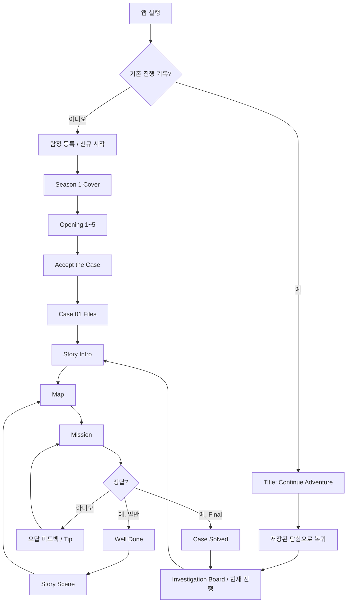

> 도식은 알려진 대표 경로를 요약한 것이다. 정확한 모든 버튼/라우트 및 저장 복귀 위치는 소스·실기기 확인 필요.

## 2. 신규 사용자 온보딩

| 단계 | 화면 | 주요 행동 | 다음 상태 |
|---|---|---|---|
| 1 | Title | 신규 탐정 시작 | Registration |
| 2 | Registration | 탐정 이름 입력·확인 | Season Cover |
| 3 | Season Cover | `BEGIN SEASON ONE` | Opening 1 |
| 4 | Opening 1~5 | 장면 순서대로 감상 | `ACCEPT THE CASE` |
| 5 | Case 01 사건 파일 | 사건 정보 확인 | `START CASE 01` |
| 6 | Story Intro | 사건 도입 읽기 | Map |
| 7 | Map | 장소 확인, `GO TO …` | Mission |

**예외/UX 점검:** 이름 입력 중 키보드 닫기, 작은 화면 CTA, 시스템 Back, 시즌 표지 재방문, 앱 중단 후 복원.

## 3. 기존 사용자 복귀

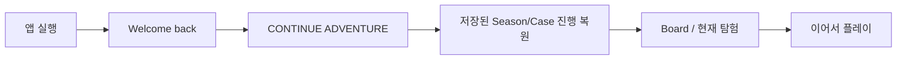

기존 사용자 Title에는 새 탐험 관련 동선도 보고되었으나 정확한 최종 문구와 초기화 확인 절차는 코드 확인이 필요하다. **이어하기는 기존 세이브를 보존**해야 한다.

## 4. Case 내부 플레이 루프

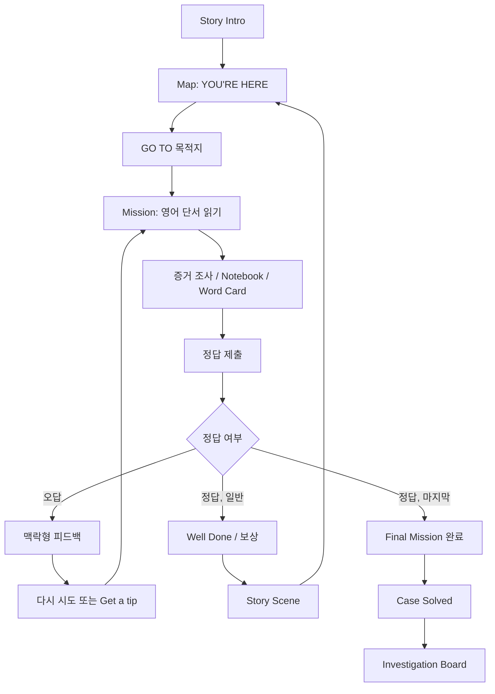

**진행 데이터:** 사건별 미션 완료, 증거, 힌트 사용, XP·Coin 지급, 시즌 완료 상태를 기록한다. 저장 시점의 세부 구현은 실제 코드 확인 필요.

## 5. GET A TIP — 핵심 상세 플로우

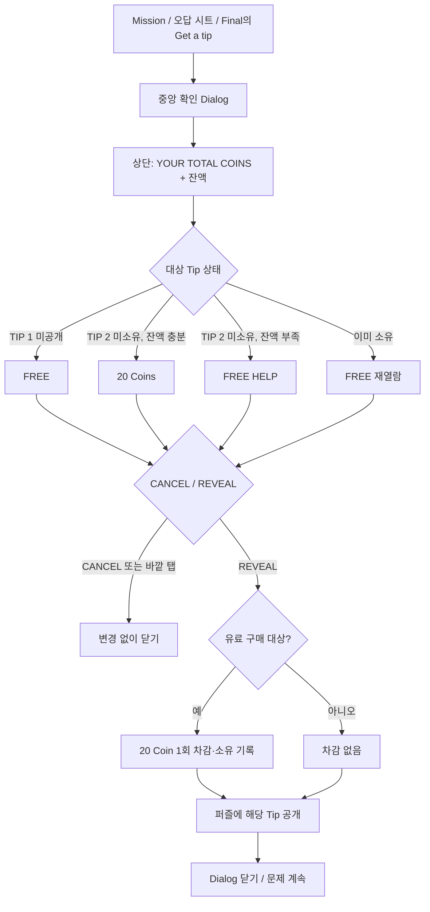

### 5.1 팝업 화면 구성

```text
┌───────────────────────────────┐
│       YOUR TOTAL COINS        │
│           ◉  360             │
│                               │
│         Reveal a tip?         │
│ Use 20 coins to reveal this   │
│             clue.             │
│           20 Coins            │
│                               │
│    [ CANCEL ]   [ REVEAL ]    │
└───────────────────────────────┘
```

숫자는 예시이며 실제 Wallet 잔액을 표시한다. TIP 1이면 `FREE`, 부족하면 무료 도움 안내, 이미 소유한 Tip이면 무료 재열람 안내로 바뀐다.

### 5.2 인터랙션 상세

| 이벤트 | 예상 결과 | Coin 변화 |
|---|---|---:|
| TIP 1 → REVEAL | TIP 1을 퍼즐 화면에 공개 | 0 |
| TIP 2(충분) → REVEAL | TIP 2 공개·소유 기록 | -20 |
| TIP 2(부족) → REVEAL | 무료 도움으로 공개 | 0 |
| 소유한 Tip → REVEAL | 무료 재열람 | 0 |
| CANCEL / 바깥 탭 | 닫기, 상태 유지 | 0 |
| REVEAL 연속 탭 | 공개 및 거래 1회만 처리 | 최대 -20 |
| 앱 재시작 후 재열람 | 소유권 복원 후 무료 열람 | 0 |

**핵심 UX 원칙:** 큰 상점 시트, 카드 목록, UNLOCK 단계 없이 **Get a tip → 잔액·가격 확인 → REVEAL → 퍼즐에서 Tip 확인**으로 끝낸다.

## 6. 오답 및 도움 플로우

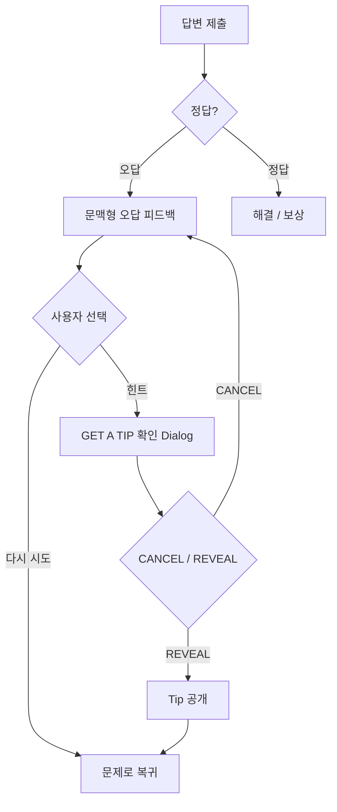

Tip의 문구는 원래 설계된 2단계 Hint를 사용하며, 정답을 그대로 누설하지 않도록 한다.

## 7. 보상·지갑 플로우

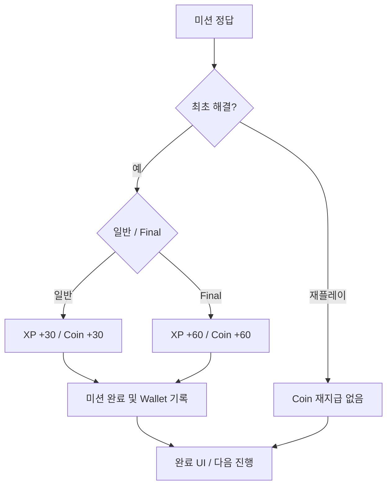

- 최초 Wallet에는 시작 지원금 20 Coins.
- 과거 완료 기록은 Rules V3 XP를 보존하면서 Coin을 1회 소급 지급.
- Tip 구매와 미션 보상은 각각 중복 처리하지 않음.
- Final 재플레이의 XP 표시는 현재 회차 규칙을 따를 수 있으나, Coin은 재지급되지 않음.

## 8. Notebook / Word Card / Archive

| 진입 | 사용자 행동 | 결과 |
|---|---|---|
| Mission 또는 공통 탐색 UI | Notebook 열기 | 획득한 증거·기록 확인 |
| Story/미션의 단어 | Word Card 열기 | 문맥에 맞는 단어 뜻 확인, 조회 이력 기록 |
| Archive | 이전 Case의 증거 다시 확인 | 후속 사건 추리 지원 |
| Operator Mode의 타 Case Archive | 읽기 전용 열람 | XP·Coin·진행을 임의 변경하지 않는 조회 흐름 |

Case 간 증거 회수의 예: Case 03의 빨간 버튼 → Case 08, Case 01 Old Letter → Case 11, Case 04 빨간 시계 → Case 12.

## 9. Final Mission → Case Solved → 다음 사건

| 단계 | 화면 | 동작 |
|---|---|---|
| 1 | Final Mission | 마지막 단서 해석 및 정답 제출 |
| 2 | Final 해결 직후 | 실제 지급된 XP/Coin만 표시 |
| 3 | CONTINUE | Case Solved로 이동 |
| 4 | Case Solved | 사건 해결 연출·결과 확인 |
| 5 | Investigation Board | 완료 상태 확인, 다음 Case 탐험 |
| 6 | Season 1 마지막 Case | 시즌 결말 및 다음 시즌 암시 |

Case 12의 Clockmaker 결말과 Paris 시계는 후속 시즌을 암시하지만, Season 2는 현재 구현 범위에 포함되지 않는다.

## 10. 보호자 플로우

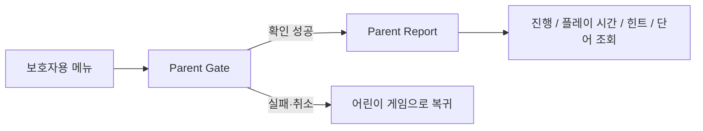

Report는 활동 기반으로 표시하고, 영어 능력이나 학습 향상을 검증 없이 단정하지 않는다. Parent Gate의 정확한 인증 문항/동작은 최종 소스 확인 필요.

## 11. Operator Mode (개발/테스트 전용)

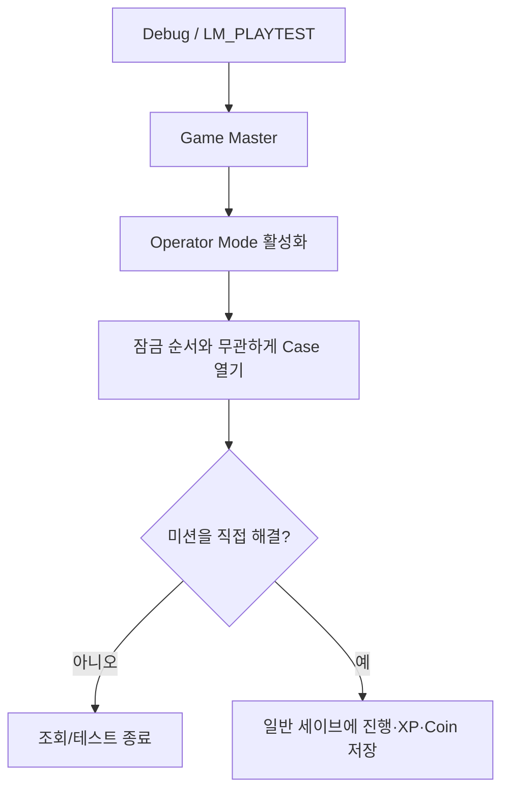

**주의 문구:** `Operator Mode lets you open cases for testing. If you solve missions, your progress and rewards will be saved.`  
별도 테스트용 세이브는 없으며, 일반 출시 빌드에는 노출되지 않는 것으로 보고되었다.

## 12. 예외 및 복구 플로우

| 상황 | 기대 동작/현재 제약 |
|---|---|
| Coin 잔액 부족 | Tip 2 무료 도움, 학습 진행 유지 |
| REVEAL 연타 | 단일 거래 및 단일 공개 |
| Dialog 바깥 탭 | CANCEL과 동일 |
| 팝업 닫는 중 재빌드 | 팝업 생성 시 고정한 Tip 번호 유지 |
| 이미 구매한 Tip | 무료 재열람 |
| 앱 종료·재시작 | 저장된 진행·지갑·소유권 복원 |
| 기존 세이브 업그레이드 | 시작 지원금·기존 완료 Coin 소급, XP 유지 |
| 전체 초기화 | Wallet 포함 새로 시작 |
| 진행 저장 후 Wallet 쓰기 유실 | 보상 누락 가능성 보고됨; 개선 과제 |
| 시스템 Back / 키보드 / 화면 크기 | 일부 수정 보고, 실제 기기 최종 QA 필요 |

## 13. 수동 QA 시나리오

1. 신규 탐정 등록 → 시즌 오프닝 → Case 01 첫 미션 진입.
2. TIP 1 팝업 확인 → CANCEL → 재진입 → REVEAL → 무료 공개.
3. TIP 2 팝업에서 Coin 잔액·가격 확인 → CANCEL → 재진입 → REVEAL → 정확히 20 차감.
4. TIP 2 재열람·재플레이·앱 재시작 후 무료 확인.
5. 잔액 부족 조건에서 무료 도움으로 미션 진행 가능 확인.
6. 일반 미션 최초 완료 시 +30 Coin, 재플레이 시 Coin 재지급 없음.
7. Final 최초 완료 시 +60 XP/+60 Coin, 재방문 시 허위 보상 표시 없음.
8. Notebook과 이전 Case 증거를 실제 추리에 재사용.
9. Case Solved → Board → 다음 Case 진입.
10. 기존 Rules V3 세이브를 불러와 XP·배지 보존 및 Coin 소급 확인.
11. 360×640, 390×844, 글자 1.3배에서 팝업과 CTA 확인.
12. 실제 기기에서 시스템 바, 뒤로가기, 폰트, Coin 아이콘, 오디오 확인.

## 14. 검증 현황

- **구현 보고:** GET A TIP Compact Dialog, Operator Mode A안 안내, XP Rules V4, Wallet, 기존 세이브 호환.
- **자동 테스트 보고:** `flutter analyze` 0 issues, `flutter test` 1,105 passed.
- **미검증:** 실제 기기 전체 UX, 실제 어린이·보호자 플레이테스트, 출시 스토어 적합성.
