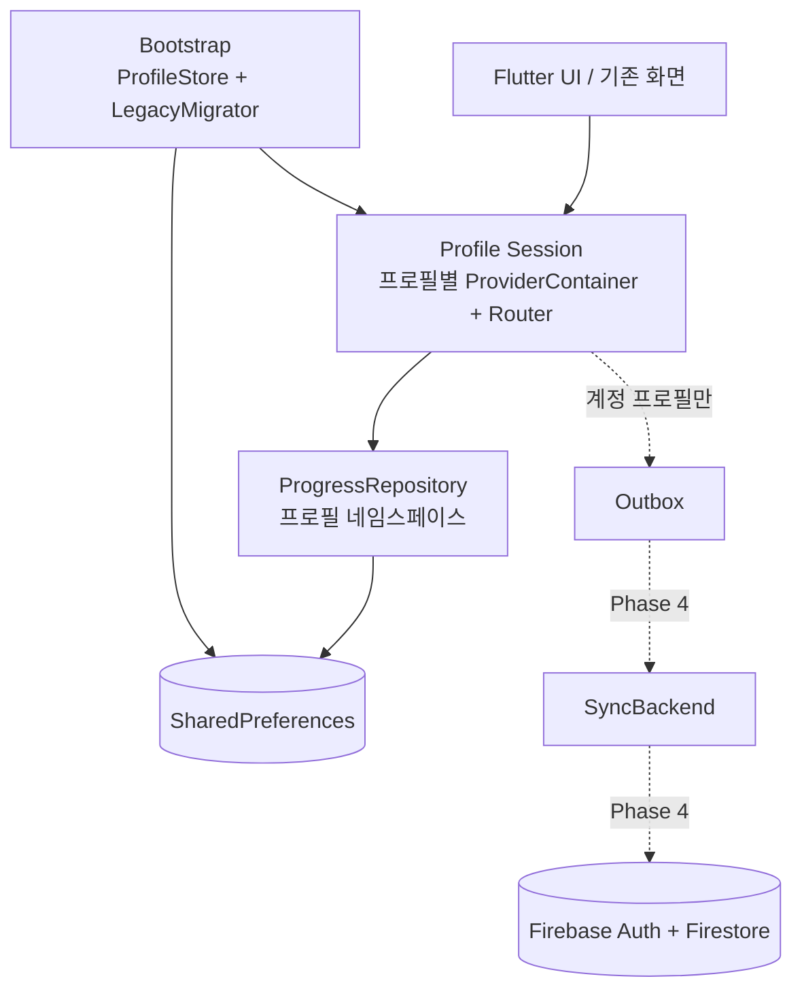
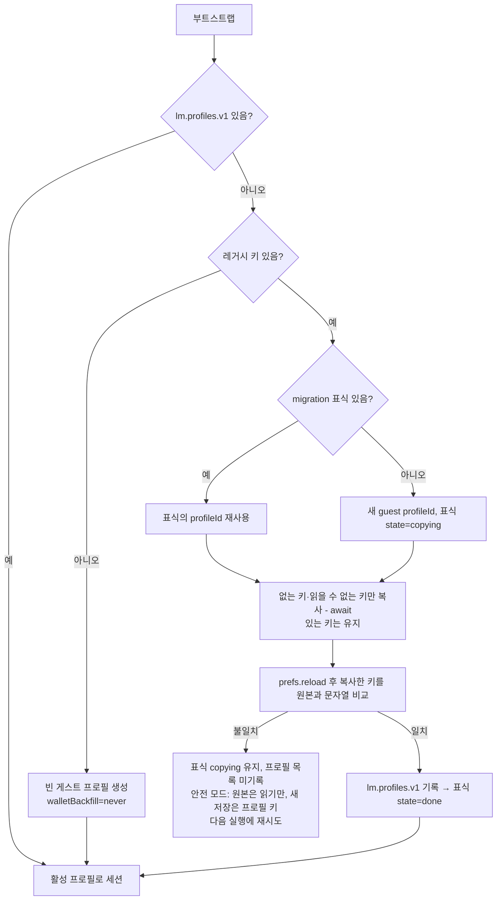

# London Mystery — Online Account & Cloud Save Design

> **문서 상태:** 소스 대조 완료(2026-10-13) · **D3 = B안(게스트 우선 + 선택적 부모 계정 연결) 확정** · 구현 승인 전
> **기준:** 실제 저장소 `lib/`, `test/`, `pubspec.yaml`. 코드 경로는 2026-10-13 `main` 기준.
> **표기:** `[CURRENT]` 소스에서 확인된 기존 구현 · `[PLANNED]` 신규 개발 예정 · `[DECISION]` 확정 · `[OPEN]` 결정 필요
> **⚠ 정책 변경 (2026-10-13):** 부모 계정 + 자녀 프로필 구조는 폐기하고 **일반 사용자 계정 + 탐정 프로필** 구조로 변경했다. 흐름: 앱 실행 → 로그인/회원가입/게스트 → 탐정 이름·프로필 → Season 1 → 저장·계정 연동. 게스트 플레이는 유지. 이 문서의 "부모/보호자 계정", "자녀 프로필"은 각각 "사용자 계정", "탐정 프로필"로 읽는다. 단, **한국 만 14세 미만 사용자의 개인정보 처리와 법정대리인 동의 의무는 별개로 유효**하며, 동의 절차가 확정되기 전에는 개인정보 클라우드 업로드를 차단한다(이메일 인증 ≠ 법정대리인 동의). 코드 명칭: `AuthService`, `UserSession`, `FirebaseAuthService`, `FakeAuthService`, `ConsentRepository`.

## 1. 목표와 설계 상태

**[DECISION]**
- 회원가입 없이 **게스트 탐정**으로 체험한다. 게스트는 현재 기기에서만 저장되며 클라우드 백업·기기 간 복원이 없다.
- 보호자는 원할 때 부모 계정을 만들거나 로그인하고, 게스트 기록을 **특정 자녀 프로필에 연결**한다.
- 부모 계정 1개 아래 자녀 탐정 프로필 N개. 프로필별 저장·지갑 완전 분리.
- 게스트 기록을 연결해도 로컬 원본을 즉시 삭제하지 않는다.
- 보호자 동의가 필요한 개인정보 처리·온라인 기능은 동의 절차 완료 전까지 비활성.
- Season 1의 12 Cases / 50 Missions와 게임 플레이, 경제 수치, GET A TIP은 변경하지 않는다.

**[OPEN]** Firebase Authentication + Cloud Firestore는 우선 후보다. SDK 설치·프로젝트 생성은 Phase 3에서 별도 승인한다.

## 2. 현재 구현 요약 [CURRENT]

| 영역 | 코드 | 사실 |
|---|---|---|
| 저장 인터페이스 | `lib/data/repositories/progress_repository.dart` | `ProgressRepository`(동기 load / 비동기 save), `SharedPrefsProgressRepository`, `InMemoryProgressRepository` |
| 저장 키 | `lib/core/constants/app_constants.dart` | `lm.progress.v1`, `lm.progress.v1.epNN`, `lm.season.v1`, `lm.wallet.v1`, `lm.settings.sound` — 기기 전역 |
| 상태 | `lib/features/game/game_providers.dart`, `game_controller.dart`, `wallet_controller.dart` | `build()`에서 `ref.read(progressRepositoryProvider)` → 저장소가 바뀌어도 자동 재계산 안 됨 |
| 탐정 이름 | `GameProgress.detectiveName` | Case 세이브마다 저장, `openEpisode`가 다음 Case로 복사 |
| Case 세이브 | `GameProgress` | 회차 상태. `playAgain()` → `resetCase()`가 완료·XP 규칙·배지·힌트 삭제 |
| Season | `SeasonProgress` | `solvedEpisodeIds`는 단조 증가, `activeEpisodeId`는 비단조 |
| Wallet | `Wallet`/`CoinEntry` | 키(`start`, `mission:<id>`, `tip:<mid>:<n>`) 1회 기록, 잔액 = 합계. Wallet이 없으면 소급 지급 |
| 초기화 | `GameController.resetAll()` → `clear()` | 모든 Case·Season·Wallet 키 삭제. Title의 「Start a New Adventure」, Game Master 초기화, Operator 「CASE NN부터」가 호출 |
| 접근 통제 | `app_router.dart` redirect, `ParentGate` | 라우터 가드가 진행 상태로 판단. Parent Gate는 곱셈 퀴즈 |
| 개발 도구 | `operatorToolsInBuild` = `kDebugMode || LM_PLAYTEST` | Operator로 푼 미션은 일반 세이브에 저장(A안) |

## 3. 목표 구성



- 게임 화면은 지금처럼 동기 로컬 저장소만 본다. 네트워크는 프로필 세션 밖의 Sync 계층이 담당한다.
- 게스트 프로필에는 outbox·Sync가 붙지 않는다.

## 4. 로컬 저장 구조 [PLANNED — Phase 1]

Phase 1 구현 기준(`lib/data/models/profile.dart`, `lib/data/repositories/profile_store.dart`, `legacy_migrator.dart`):

```text
lm.profiles.v1                {schema, activeProfileId, profiles:[
                                 {id, kind: guest|account, detectiveName?,
                                  createdAt, origin: legacy|fresh|playtest,
                                  walletBackfill: pending|done|never}]}
                              (Phase 4 추가 예정: ownerUid, linkedTo / lm.device.v1 installId)
lm.migration.legacy.v1        {state: copying|done, profileId, startedAt, doneAt, keys:[…]}
lm.p.<profileId>.legacy.cleared  (안전 모드에서 새 모험 시작 시에만)
lm.p.<profileId>.progress.v1           ← Case 01
lm.p.<profileId>.progress.v1.<epNN>    ← Case 02~12
lm.p.<profileId>.season.v1
lm.p.<profileId>.wallet.v1
lm.settings.sound             (기기 설정, 그대로)
lm.progress.v1 … lm.wallet.v1 (레거시 원본, 읽기 전용 보존)
```

- `profileId`/`installId`: `Random.secure()` 128bit hex (패키지 불필요).
- 값 형식은 기존 JSON 그대로. `GameProgress`/`SeasonProgress`/`Wallet`의 `fromJson`은 변경 없이 재사용.
- 프로필 키 함수는 `AppConstants`에 두고, 기존 `progressKeyFor`는 레거시 키 계산용으로 유지.

## 5. 프로필 세션 격리 [PLANNED — Phase 1]

**문제:** 상태 provider가 `ref.read`로 저장소를 읽고, 라우터·일회성 권한(`parentReportAccessProvider`, `gameMasterAccessProvider`, `operatorAccessSwitchProvider`, `recentSolveProvider`)이 전역 컨테이너에 있다. 저장소만 바꾸면 이전 프로필 상태가 남는다.

**결정 방향:** 프로필마다 **새 `ProviderContainer`**를 만든다. 전환 시 기존 컨테이너를 dispose하고, 새 컨테이너를 `UncontrolledProviderScope(key: ValueKey(profileId))`로 붙인다. 라우터도 컨테이너 안의 provider이므로 함께 새로 만들어진다.

| 대안 | 장점 | 단점 |
|---|---|---|
| **A. 프로필별 컨테이너 재생성 (권장)** | 모든 상태·라우터·권한이 한 번에 사라짐; 기존 provider 코드 변경 최소 | 오디오 서비스도 재생성(전환 시 소리 재시작) |
| B. 저장소 provider가 활성 프로필을 watch | 컨테이너 1개 | 모든 `ref.read(repo)`를 `watch`로 바꿔야 하고, 일회성 상태 누락 위험 |
| C. 중첩 `ProviderScope` override | 선언적 | Riverpod 3에서 scoped override는 의존 provider마다 `dependencies` 선언 필요 → 광범위 수정 |

`progressRepositoryProvider`는 `activeProfileIdProvider`(세션 생성 시 override)를 사용해 `SharedPrefsProgressRepository(prefs, profileId: …)`를 만든다.

## 6. 레거시 → 게스트 이전 [PLANNED — Phase 1]



- **원본 보존:** 레거시 키는 읽기만 한다. `clear()`는 프로필 네임스페이스만 지운다. 레거시 원본 삭제는 Game Master 「다음 플레이어를 위해 초기화」(`resetForNextPlayer` → `ProfileStore.wipeLegacy`)에서만 하며, 부분 실패 시 남은 키를 알리고 재시도할 수 있다(반복 실행 안전, 프로필 목록이 있으므로 원본이 다시 복사되지 않음).
- **멱등:** 프로필 목록이 있으면 재실행하지 않는다. 목록을 기록한 뒤 마지막에 표식을 `done`으로 바꾸고, 그 사이에 중단되면 다음 실행에서 `done`으로 정리한다.
- **소급:** 레거시에 `lm.wallet.v1`이 없으면 `walletBackfill: pending` → `WalletController`가 그 프로필에서 1회 소급하고 `done`으로 바꾼다. 새 프로필(`never`)은 시작 Coin만 받는다. 이로써 "Wallet이 없으면 언제든 소급"하는 현재 동작을 레거시 1회로 제한한다.
- **이름:** 프로필 `detectiveName` = 활성 Case의 이름, 없으면 다른 Case의 첫 이름. Case 세이브의 `detectiveName`은 그대로 둔다.
- **XP:** `xpRules`(V1~V3 기록 포함)는 바이트 그대로 복사하며 재계산하지 않는다.

## 7. Case 회차 모델 [PLANNED — 필드는 Phase 1, 병합은 Phase 2]

`GameProgress`에 추가(모두 선택적, 없으면 기존 형식 그대로 저장):

| 필드 | 의미 | 생성/변경 |
|---|---|---|
| `runId` | 회차 식별자 | 회차가 처음 저장될 때 생성; `resetCase()`(Play Again)·새 프로필에서 새로 생성 |
| `runSeq` | 회차 순번 | Play Again마다 +1 (레거시 = 0) |
| `rev` | 회차 안 저장 번호 | `_update` 저장마다 +1 |

**병합 규칙(Phase 2, 순수 Dart):**
- 같은 `runId` → 완료·증거·단어·배지 합집합(완료 순서는 먼저 기록된 쪽 우선), 시도·오답·힌트 수 최댓값, `playMillis` 최댓값, `completedAt`은 존재하는 값.
- 다른 `runId` → `runSeq` 큰 쪽 채택. **Play Again 이후 이전 회차가 되살아나지 않는다.**
- `runSeq` 같고 `runId` 다름 → 진행(완료 수, 그다음 `rev`)이 많은 쪽 채택, 다른 쪽은 `lm.p.<pid>.backup.<epNN>.<runId>`에 보관.
- 레거시 세이브(`runId` 없음)는 이전 시 `runId`를 부여하지 않고, 처음 저장될 때 부여한다.

## 8. Wallet 규칙 [PLANNED — Phase 2·4]

**유지:** `CoinEntry.key` 1회 기록, 잔액 = 합계, 소스 이름 불변(`CoinSource`는 추가만).

### 8.1 같은 키, 다른 금액
- `mission:<id>`: 금액이 카탈로그(30/60)로 결정되므로 `mission`과 `backfill` 소스 차이만 가능 → 먼저 기록된 항목 유지, 금액 동일.
- `tip:<mid>:2`: 기기 A는 `-20`(구매), 기기 B는 `0`(무료 도움)일 수 있음 → **서버에 먼저 생성된 항목이 기준**. 로컬 항목을 서버 값으로 교체하고 차이를 진단 로그에 남긴다. TIP 소유권은 어느 쪽이든 유지된다.
- `start`: 프로필당 1개, 금액 20 고정.

### 8.2 중복 소급 방지
- 소급은 `walletBackfill: pending` 프로필에서만 1회(§6).
- 계정 프로필을 새 기기에서 열 때는 클라우드 Wallet 수신이 끝난 뒤 로컬 Wallet을 만든다. 수신 전에는 GET A TIP 잔액 표시를 "동기화 중"으로 둘지 [OPEN].

### 8.3 오프라인 동시 구매로 인한 음수 잔액 — 대안 비교 [OPEN]

예: 잔액 20, 기기 A와 B가 오프라인에서 서로 다른 TIP 2를 구매 → 병합 잔액 −20.

| 대안 | 동작 | 장점 | 위험 |
|---|---|---|---|
| A. 자동 보정 지급 | `reconcile` 항목으로 0까지 채움 | 단순, 음수 없음 | 근거 없는 Coin 생성; 반복 악용(두 기기 고의 구매) 가능; 회계 의미 흐림 |
| **B. 부채 허용 + 표시 0 하한 (권장 MVP)** | 장부는 −20 그대로, 화면은 `max(0, 잔액)`. 가격 판단도 하한 잔액 사용 → 부채 중에는 TIP 2가 기존 「무료 도움」 규칙으로 처리됨. 다음 보상이 부채를 먼저 갚음 | 장부가 사실 그대로; Coin 생성 없음; 기존 무료 도움 규칙과 자연스럽게 맞음; 서버 로직 불필요 | "+30 COINS" 직후 잔액이 30보다 적게 오를 수 있음(부채 상환) → 문구 처리 필요; `Wallet.balance` 의미 변경 시 테스트 영향 |
| C. 서버 순서 확정 | 서버(Functions)가 도착 순서로 처리, 잔액 부족 구매를 `0`(도움)으로 확정 | 가장 정확, 음수 없음 | Cloud Functions(Blaze) 필요; 클라이언트가 확정 전 금액을 바꿔야 함 |
| D. 온라인 전용 유료 구매 | 오프라인 TIP 2는 무료 도움 처리 | 음수 원천 차단 | 오프라인에서 경제 규칙이 달라짐(GET A TIP 변경 금지 원칙 위반 소지), 비행기 모드 악용 |
| E. 기기별 오프라인 한도 | 오프라인 구매를 기기 예약분 안에서만 | 음수 차단 | 복잡, 아이에게 설명 불가 |

권장: MVP는 **B**, 결제·광고 등 Coin이 현금 가치와 연결되는 시점에 **C**로 이행. A는 채택하지 않음(사용자 지침).

## 9. 게스트 → 자녀 프로필 연결 [PLANNED — Phase 4]

**전제:** 보호자 인증 + 동의 완료 + 온라인.

| 상황 | 기본 제안 | 선택지 | 처리 |
|---|---|---|---|
| 새 자녀 프로필 | 연결 | 연결 / 나중에 | 게스트 데이터를 새 `profileId`(서버 발급)로 업로드 |
| 기존 프로필, 클라우드 기록 없음 | 연결 | 연결 / 다른 프로필 / 나중에 | 업로드 |
| 기존 프로필, 클라우드 기록 있음 | **새 프로필로 연결** | 클라우드 유지 / 합치기 / 새 프로필 | 합치기 = Season 합집합 + Wallet 키 합집합(§8.1) + Case 회차 규칙(§7), 밀린 회차는 로컬 백업 |
| 이미 다른 프로필에 연결된 게스트 | 경고 | 재연결 / 취소 | 같은 진행이 두 자녀에게 복사됨을 안내 |

- 비교 화면: 양쪽의 해결 Case 수, Coin, 총 XP, 마지막 진행 Case, 마지막 플레이 일시.
- 최종 확인은 보호자 영역에서만. 아이 화면에서는 연결을 시작할 수 없다.
- 기록: 서버 `migrations/{installId}`(연결 대상·시각·요약), 로컬 프로필 `linkedTo`.
- 멱등: Wallet 항목은 키가 문서 ID라 재전송이 무해. Case는 `runId`+`rev`로 같은 회차 재전송을 무시.
- 원본: 게스트 네임스페이스와 레거시 키 모두 보존. 삭제 시점 [OPEN].
- Wallet 합치기는 같은 키를 한 번만 세므로 양쪽 합계보다 커지지 않는다.

## 10. 클라우드 데이터 모델 [PLANNED — Phase 4, 이름 미확정]

```text
parents/{uid}                     locale, region, consent{version, at}, createdAt   ← 이메일은 Auth에만
  profiles/{pid}                  detectiveName, createdAt, schemaVersion
    cases/{episodeId}             runId, runSeq, rev, progress(JSON), updatedAt(server), deviceId
    season/state                  solvedEpisodeIds(arrayUnion), activeEpisodeId, updatedAt
    wallet/{entryKey}             amount, source, at(device), serverAt   ← create only
    migrations/{installId}        linkedAt, fromProfileKind, summary
```

**보안 규칙 초안:** `request.auth.uid == uid`; `wallet` 생성만 허용(수정·삭제 금지), 소스별 금액 화이트리스트(`start`=20, `mission`/`backfill` ∈ {30, 60}, `tip` ∈ {0, −20}), 키 형식 검증. 미션 ID↔금액 매핑은 규칙에서 참조 가능한 형태로 둔다(ID 규칙 확인 필요). 문서 크기는 Case당 수 KB로 1MB 제한과 무관.

**검증 한계:** 정답 데이터가 앱에 있으므로 서버는 "실제로 풀었는지"를 검증할 수 없다. 금액·키·소유권만 검증한다. 현금 가치가 없는 MVP에서는 수용 가능.

## 11. 개발 데이터 분리 [PLANNED]

| 계층 | 방법 | 단계 |
|---|---|---|
| 빌드 | debug / `LM_PLAYTEST` 빌드는 개발 Firebase 프로젝트 또는 Emulator에만 연결. 운영 설정 파일은 release flavor에만 포함 | 3 |
| 프로필 | `origin: playtest` 프로필(`DetectiveProfile.syncable == false`)은 연결·동기화 대상에서 영구 제외. 「CASE NN부터」 실행, 또는 일반 규칙상 잠긴 Case에서 미션을 해결할 때 기록(스위치 ON만으로는 기록하지 않음). 프로필 전체 초기화 시 해제 | 1(기록, 구현됨)·4(적용) |
| Operator 도구 | A안 유지(활성 프로필에 저장) + playtest 출처 기록 [DECISION Q-4]. 샌드박스 분리는 Phase 3 재검토 | 1 |
| 비밀정보 | Firebase 설정·키는 저장소에 커밋하지 않고 CI 시크릿/로컬 파일로 주입 | 3 |

## 12. 결정 필요 항목

| # | 항목 | 권장 |
|---|---|---|
| D-1 | 백엔드 | Firebase Auth + Firestore(`asia-northeast3`), MVP는 Functions 없이 |
| D-2 | 인증 수단 | 이메일 + Google + Apple; Kakao는 Functions 필요로 2차 |
| D-3 | 기기당 게스트 수 | **확정(Q-1):** 1명. 구조는 N명 지원 |
| D-4 | 레거시 원본 보존 | **확정(Q-2):** Game Master 「다음 플레이어」 초기화에서만 삭제. 일반 초기화·Play Again·프로필 전환에서는 삭제 금지. 그 외 보존 기간은 [OPEN] |
| D-5 | Operator 도구 대상 | **확정(Q-4):** A안 유지 + `origin: playtest` 기록, 향후 운영 클라우드 동기화에서 반드시 제외 |
| D-6 | 새 모험 시작 | 게스트(Phase 1): 같은 게스트 프로필의 네임스페이스만 비움(프로필 ID 유지, 레거시 원본·다른 프로필 유지). 게스트는 동기화 대상이 아니므로 ID 재발급이 불필요하고, 실행 중인 세션을 폐기하지 않아 안전. 계정 프로필(Phase 4): 보호자 인증 + 각 Case 새 회차로 기록(클라우드 삭제 아님) |
| D-7 | 음수 잔액 | Phase 2에서 최종 결정(§8.3 B안 권장). Phase 1은 보정 지급·잔액 조작 없음 |
| D-8 | 연결 충돌 기본값 | 클라우드 기록이 있으면 "새 프로필로 연결" |
| D-9 | 언어/지역 범위 | MVP 한국/한국어 UI 하나, 기기 단위 |
| D-10 | 지원 플랫폼 | Android/iOS. web/windows는 개발용 |
| D-11 | 동의 방식 | 법률 검토 후 확정 |
| D-12 | 자녀 프로필 수 제한·삭제 | 예: 4개, 삭제 시 하위 데이터 전체 삭제 |

## 13. 단계별 구현 계획

| Phase | 범위 | 승인 게이트 |
|---|---|---|
| 1 | 로컬 프로필 저장·게스트·레거시 이전·세션 격리·회차 필드 (`docs/PHASE1_LOCAL_PROFILES_PLAN.md`) | 패키지 없음, 기존 테스트 전체 통과 |
| 2 | outbox, 병합 함수, Wallet 충돌·부채 처리, 초기화 범위 | 속성 테스트 통과 |
| 3 | 언어/지역·진입 선택 UI, 동의, 부모 인증, 환경 분리 | **Firebase 패키지 설치 별도 승인**, 법률 검토 |
| 4 | 계정 프로필 동기화, 게스트 연결, 충돌 UX | 보안 규칙 테스트, 두 기기 시나리오 |
| 5 | 보호자 영역(프로필 관리, 탈퇴) | 정책 확정 |
| 6 | 출시 QA | 실기기, 아동/보호자 테스트 |

## 14. 결정 로그

| 날짜 | 결정 | 비고 |
|---|---|---|
| 2026-10-13 | 오프라인 중심 앱을 온라인 계정 기반 서비스로 확장 | 기존 Season 1 보존 |
| 2026-10-13 | 부모 계정 + 복수 자녀 탐정 프로필 | 자녀별 데이터 분리 |
| 2026-10-13 | Firebase Auth/Firestore 우선 평가 | 최종 선정 아님 |
| 2026-10-13 | **D3 = B안: 게스트 우선 체험 + 선택적 부모 계정 연결** | 게스트 클라우드 없음, 원본 즉시 삭제 금지, 동의 전 온라인 비활성 |
| 2026-10-13 | Phase 1은 패키지 없이 로컬 다중 프로필 구조 | `ProgressRepository`·SharedPreferences 재사용 |
| 2026-10-13 | Case 저장은 회차 단위 → `runId`/`rev` 도입 방향 | Play Again 기록 부활 방지 |
| 2026-10-13 | 음수 잔액 자동 보정 지급은 즉시 확정하지 않음 | §8.3 대안 비교 |
