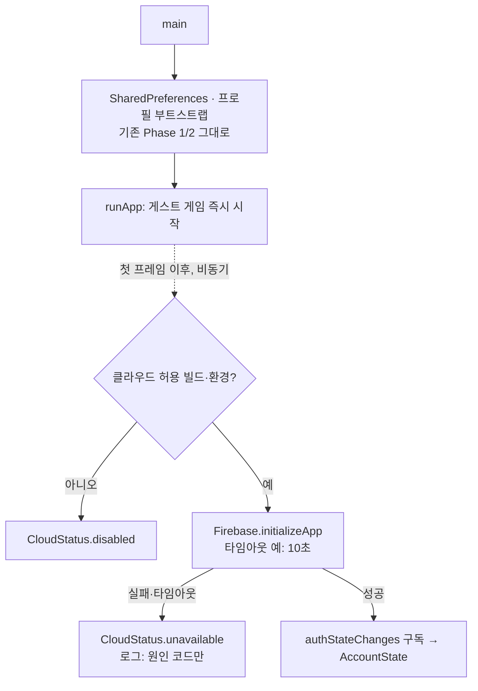

# Phase 3A — Firebase 부모 계정 인증 기반 (설계 · 준비사항)

> **상태:** 분석·설계 완료 / 구현 승인 전 (2026-10-13) · 패키지 설치·프로젝트 생성·인증 코드 없음
> **범위:** 부모 인증·환경 분리·계정/프로필 연결 구조·보안 규칙. **Case/Season/Wallet 업로드는 Phase 4.** 게임 UI·경제 규칙·Coin 음수 정책·충돌 삭제 정책 변경 없음.
> **⚠ 정책 변경 (2026-10-13):** 부모 계정 + 자녀 프로필 구조는 폐기하고 **일반 사용자 계정 + 탐정 프로필** 구조로 변경했다. 흐름: 앱 실행 → 로그인/회원가입/게스트 → 탐정 이름·프로필 → Season 1 → 저장·계정 연동. 게스트 플레이는 유지. 이 문서의 "부모/보호자 계정", "자녀 프로필"은 각각 "사용자 계정", "탐정 프로필"로 읽는다. 단, **한국 만 14세 미만 사용자의 개인정보 처리와 법정대리인 동의 의무는 별개로 유효**하며, 동의 절차가 확정되기 전에는 개인정보 클라우드 업로드를 차단한다(이메일 인증 ≠ 법정대리인 동의). 코드 명칭: `AuthService`, `UserSession`, `FirebaseAuthService`, `FakeAuthService`, `ConsentRepository`.
> **표기:** `[USER]` 사용자가 콘솔·계정에서 직접 · `[CLAUDE]` 코드에서 처리 · `[OPEN]` 결정 필요 · `[LEGAL]` 정책·법률 검토 필요

## 1. 현재 환경 점검 결과 (2026-10-13)

| 항목 | 상태 | 조치 |
|---|---|---|
| Flutter / Dart | 3.47.2 / 3.13.2 | — |
| Node / npm | v22.20.0 / 10.9.3 | Firebase CLI 설치 가능 |
| Firebase CLI (`firebase`) | **미설치** | `[USER]` `npm install -g firebase-tools` 후 `firebase login` |
| FlutterFire CLI | `flutterfire_cli 1.3.1` 전역 설치됨, **PATH 미등록** | `[USER]` `%LOCALAPPDATA%\Pub\Cache\bin`을 PATH에 추가 (또는 `dart pub global run flutterfire_cli:flutterfire`) |
| Java | 17.0.12 | Firestore 에뮬레이터(규칙 테스트)용. 최신 firebase-tools 에뮬레이터는 **JDK 21 이상**을 요구하는 것으로 알려져 있음 → 설치 시 확인, 필요하면 JDK 21 추가 |
| gcloud | 미설치 | Phase 3A에는 불필요 |
| Android applicationId | `com.londonmystery.app`, flavor 없음 | `[CLAUDE]` dev/prod flavor 추가 |
| Android release 서명 | **debug 키로 서명 중** | `[USER]` 업로드 키 생성·보관(저장소 밖). Google 로그인 사용 시 SHA-1/SHA-256 등록 필요 |
| iOS bundle ID | `com.londonmystery.app` (Android와 동일), 최소 iOS 15.0 | 그대로 사용 가능. **이 PC는 Windows → iOS 빌드·서명·`GoogleService-Info.plist` 연결 검증에 Mac 필요** |
| 플랫폼 폴더 | android, ios, web, windows | `[OPEN]` 인증은 Android/iOS만 권장. web/windows는 게스트 전용(Firebase 미초기화) |
| `.gitignore` | Firebase·서명키 항목 없음 | `[CLAUDE]` 추가(§3.4) |
| 기존 Firebase 파일 | 없음 (`google-services.json`, `GoogleService-Info.plist`, `firebase_options*.dart`) | 신규 |

## 2. 도입 범위 (Phase 3A)

| 포함 | 제외(이후 Phase) |
|---|---|
| `firebase_core`, `firebase_auth`, `cloud_firestore` (설치 시점 최신 안정판) | Case/Season/Wallet 업로드·다운로드(Phase 4) |
| 개발/운영 프로젝트 분리, flavor·환경 상수 | 게스트 → 계정 연결 실행(Phase 4) |
| 부모 인증 서비스(추상화 + Firebase 구현 + 테스트용 가짜) | 보호자 동의 UX·기록(Phase 3B, `[LEGAL]`) |
| 세션 복원·로그아웃·재인증 구조 | Cloud Functions, App Check 강제(이후) |
| `parents/{uid}`, `parents/{uid}/profiles/{profileId}` 최소 문서 | Analytics/Crashlytics(아동 대상 → 도입하지 않음) |
| Firestore 보안 규칙 초안 + 에뮬레이터 테스트 | 광고·결제 |
| 인증 수단: **이메일/비밀번호 + 비밀번호 재설정** (권장, `[OPEN]`) | Google/Apple(3B 권장: iOS에서 Google 제공 시 Apple 로그인 필수) / Kakao(Functions 필요) |

**UI:** Phase 3A는 서비스·구조만 구현하고 화면은 만들지 않음을 권장(`[OPEN]`). 보호자 로그인 화면은 동의 흐름과 함께 Phase 3B에서 Parent Gate 뒤에 둔다.

## 3. 개발·운영 프로젝트 분리

### 3.1 Firebase 프로젝트

| | 개발 | 운영 |
|---|---|---|
| 프로젝트 ID(예) | `london-mystery-dev` | `london-mystery-prod` |
| Android 앱 | `com.londonmystery.app.dev` | `com.londonmystery.app` |
| iOS 앱 | `com.londonmystery.app.dev` | `com.londonmystery.app` |
| Firestore 위치 | `asia-northeast3`(서울) — **생성 후 변경 불가** | 동일 |
| Firestore 시작 모드 | 프로덕션 모드(전부 거부)에서 규칙 배포 | 동일 |
| 사용 빌드 | debug, `LM_PLAYTEST`(Operator 도구 포함), 에뮬레이터 | release만 |
| 접근 권한(IAM) | 개발자 | 최소 인원(소유자 2명 이내 권장), 개발자는 뷰어 이하 |
| 요금제 | Spark(무료)로 충분 | Spark로 시작, Functions 도입 시 Blaze + 예산 알림 |

### 3.2 앱 쪽 환경 선택

- Android `productFlavors { dev; prod }` (dev는 `applicationIdSuffix = ".dev"`), iOS는 Debug-dev / Release-prod 구성·스킴.
- `--dart-define=LM_ENV=dev|prod`로 `firebase_options_dev.dart` / `firebase_options_prod.dart` 중 하나 선택(`flutterfire configure`로 프로젝트별 생성).
- **안전장치(코드로 강제):**
  - `operatorToolsInBuild`(debug 또는 `LM_PLAYTEST`) 빌드가 `prod` 설정을 받으면 Firebase를 초기화하지 않고 게스트 전용으로 동작 (`SyncPolicy.buildMayUseLiveCloud`와 같은 규칙).
  - `LM_ENV`가 없거나 알 수 없는 값 → 클라우드 비활성(게스트 전용).
  - 테스트·로컬 개발: `LM_FIREBASE_EMULATOR=true`면 Auth/Firestore 에뮬레이터로 연결.

### 3.3 설정 파일과 비밀정보

- **커밋 금지:** 서비스 계정 키(JSON), Android 업로드 키(`*.jks`, `key.properties`), CI 토큰.
- Firebase 클라이언트 설정(`google-services.json`, `GoogleService-Info.plist`, `firebase_options_*.dart`)의 API 키는 Firebase 공식 설명상 비밀이 아닌 식별자이나, 조직 지침(키 하드코딩 금지)에 따라 **기본은 저장소 제외 + 환경별 주입**을 권장 (`[OPEN]`: 커밋 허용 여부). 어느 쪽이든 Google Cloud 콘솔에서 **API 키 제한**(Android 패키지+SHA, iOS 번들 ID)을 건다.
- CI 배포가 필요해지면 서비스 계정 키 파일 대신 CI 비밀 저장소/워크로드 아이덴티티 사용.

### 3.4 `.gitignore` 추가 예정 `[CLAUDE]`

```
# Firebase (environment-specific client config; see docs/PHASE3A_FIREBASE_AUTH_PLAN.md)
**/google-services.json
**/GoogleService-Info.plist
lib/firebase_options_*.dart
# Signing / credentials — never commit
*.jks
*.keystore
android/key.properties
*service-account*.json
.firebaserc.local
```
(클라이언트 설정 커밋을 허용하기로 결정하면 앞의 세 줄은 제외)

## 4. 앱 구조 설계

### 4.1 게스트 우선 초기화 (Firebase 실패가 게임을 막지 않음)



- `main()`에서 Firebase 초기화를 **기다리지 않는다.** 게임 시작 경로(프로필 부트스트랩·`ProfileSessionHost`)는 Firebase를 import하지 않는다.
- 클라우드 상태는 프로필 세션 컨테이너 **밖**(기기 단위)의 객체로 두고 세션 생성 시 override로 전달 → 프로필 전환과 무관하게 유지.
- 상태: `disabled`(빌드/환경상 사용 안 함) · `initializing` · `unavailable`(실패) · `signedOut` · `signedIn(uid)`.

### 4.2 인증 서비스 추상화

```dart
abstract interface class AuthService {
  Stream<UserSession?> sessions();          // null = 로그아웃
  UserSession? get current;
  Future<AuthResult> signUpWithEmail(String email, String password);
  Future<AuthResult> signInWithEmail(String email, String password);
  Future<AuthResult> sendPasswordReset(String email);
  Future<AuthResult> reauthenticate(String password); // 계정 관리·삭제 등 민감 작업 전
  Future<void> signOut();
}
// FirebaseAuthService (firebase_auth), FakeAuthService (테스트), DisabledAuthService (게스트 전용 빌드)
```
- `AuthResult`는 일반화된 오류 코드만(`invalidCredentials`, `network`, `tooManyRequests`, `weakPassword`, `emailInUse`, `unknown`) → 화면에 내부 메시지 노출 금지, 이메일·비밀번호는 로그에 남기지 않음(마스킹).
- 계정 존재 여부를 드러내지 않도록 로그인 실패 메시지는 통합.

### 4.3 세션 복원·로그아웃

| 상황 | 동작 |
|---|---|
| 앱 재시작(온라인/오프라인) | Firebase Auth가 기기에 세션을 보관 → `authStateChanges`로 복원. 오프라인이어도 캐시된 사용자로 `signedIn` 표시, 토큰 갱신만 보류 |
| 토큰 만료·계정 비활성 | `signedOut`으로 전환. 로컬 게임은 계속(게스트·로컬 데이터) |
| 로그아웃 | 부모 세션만 종료. **게스트 프로필과 로컬 세이브는 그대로.** 계정 프로필(Phase 4 이후)의 로컬 사본 처리 `[OPEN]` — 권장: 데이터는 보존하되 같은 부모가 다시 로그인하기 전까지 선택 불가, 활성 프로필은 게스트로 |
| 다른 부모로 로그인 | 이전 부모의 계정 프로필은 목록에서 숨김(로컬 `ownerUid` 불일치) |
| 민감 작업(계정 삭제·프로필 삭제·동의 철회) | 재인증 요구 |

### 4.4 인증 ≠ 동의

- 부모 문서의 `consent.status` 기본값 `none`. **로그인·가입 성공만으로 `granted`가 되지 않는다.**
- 클라우드 기능(Phase 4 업로드, 프로필 클라우드 생성)은 `consent.status == granted`일 때만 열린다(클라이언트 + 규칙 양쪽에서 확인).
- Phase 3A 규칙은 클라이언트의 `consent` 쓰기를 **전면 거부**. 동의 기록 경로(클라이언트 기록 + 서버 시각 vs Cloud Functions 기록)는 Phase 3B에서 법률 검토 후 결정 `[OPEN][LEGAL]`.

## 5. 데이터 구조 (Phase 3A 최소)

```text
parents/{uid}                         ← uid = Firebase Auth UID (경로가 소유권)
  schema: 1
  createdAt: serverTimestamp
  locale: 'ko', region: 'KR'
  consent: { status: 'none' }         ← 클라이언트 수정 불가 (3B에서 경로 결정)
  (이메일은 저장하지 않음 — Auth에만)

parents/{uid}/profiles/{profileId}    ← profileId = 기존 로컬 프로필 ID(32자리 hex)를 그대로 사용
  schema: 1
  detectiveName: string(1–12)
  createdAt: serverTimestamp
  (Phase 4 추가: linkedFromInstallId, cases/*, season/*, wallet/*)
```

**연결 방식:** 로컬 `DetectiveProfile`에 `ownerUid`를 추가(Phase 3A 모델만, 선택 필드) → 클라우드 문서 경로 `parents/{ownerUid}/profiles/{id}`와 1:1. 프로필 ID는 기기에서 오프라인으로 생성 가능(충돌 확률 무시 가능). `installId`는 연결 기록용 메타데이터일 뿐 소유권 판단에 쓰지 않는다.

## 6. Firestore Security Rules 초안

```
rules_version = '2';
service cloud.firestore {
  match /databases/{database}/documents {
    function signedIn() { return request.auth != null; }
    function isOwner(uid) { return signedIn() && request.auth.uid == uid; }
    function validName(n) { return n is string && n.size() >= 1 && n.size() <= 12; }

    match /parents/{uid} {
      allow read: if isOwner(uid);
      allow create: if isOwner(uid)
        && request.resource.data.keys().hasOnly(['schema', 'createdAt', 'locale', 'region', 'consent'])
        && request.resource.data.schema == 1
        && request.resource.data.createdAt == request.time
        && request.resource.data.consent == {'status': 'none'};
      allow update: if isOwner(uid)
        && request.resource.data.diff(resource.data).affectedKeys().hasOnly(['locale', 'region']);
      allow delete: if false;   // 계정 삭제는 신뢰 경로(이후 결정)

      match /profiles/{profileId} {
        allow read: if isOwner(uid);
        allow create: if isOwner(uid)
          && profileId.matches('^[0-9a-f]{32}$')
          && request.resource.data.keys().hasOnly(['schema', 'detectiveName', 'createdAt'])
          && request.resource.data.schema == 1
          && validName(request.resource.data.detectiveName)
          && request.resource.data.createdAt == request.time;
        allow update: if isOwner(uid)
          && request.resource.data.diff(resource.data).affectedKeys().hasOnly(['detectiveName'])
          && validName(request.resource.data.detectiveName);
        allow delete: if false;  // 삭제 정책 확정 전

        // 게임 데이터(Phase 4)는 아직 전부 닫는다.
        match /{document=**} { allow read, write: if false; }
      }
    }
    match /{document=**} { allow read, write: if false; }
  }
}
```

- 프로필 생성은 동의 완료 후로 제한할 예정(Phase 3B에서 `get(/parents/$(uid)).data.consent.status == 'granted'` 조건 추가) `[OPEN]`.
- 자녀 프로필 수 제한은 규칙만으로 세기 어려움 → 부모 문서 카운터 + 트랜잭션 또는 Functions `[OPEN]`.

### 6.1 규칙 테스트 계획 (`@firebase/rules-unit-testing` + Firestore 에뮬레이터)

`firebase/` 폴더(Node, 앱과 분리)에 규칙·테스트를 두고 `npm test`로 실행.

| # | 시나리오 | 기대 |
|---|---|---|
| R1 | 비로그인 사용자가 `parents/*` 읽기/쓰기 | 거부 |
| R2 | 부모 A가 자기 문서 생성(정상 필드) | 허용 |
| R3 | 부모 A가 `parents/B` 읽기·쓰기·프로필 읽기 | **거부** |
| R4 | 부모 A가 `consent.status: 'granted'`로 생성 또는 수정 | 거부 |
| R5 | 허용되지 않은 필드(이메일 등) 포함 생성 | 거부 |
| R6 | `createdAt`을 임의 시각으로 생성 | 거부 |
| R7 | 프로필 ID 형식 위반, 이름 13자 이상·빈 이름 | 거부 |
| R8 | 프로필 `detectiveName` 외 필드 수정 | 거부 |
| R9 | 프로필 하위 게임 데이터 경로 쓰기(`cases/ep01` 등) | 거부(Phase 4 전) |
| R10 | 부모·프로필 삭제 | 거부 |
| R11 | 정의되지 않은 최상위 컬렉션 | 거부 |

### 6.2 앱 쪽 테스트 계획 (Dart, 가짜 인증)

- Firebase 초기화 실패·타임아웃 → 게스트 게임 시작·저장 정상(기존 1,182 테스트 + 신규).
- Operator 빌드 + prod 설정 → 클라우드 비활성.
- 로그인/로그아웃/세션 복원 → 게스트 프로필·로컬 세이브 불변.
- 오류 코드 일반화(내부 메시지 미노출), 로그에 이메일·비밀번호 없음.
- 인증 완료 후에도 `consent.status != granted`면 클라우드 기능 잠김.

## 7. 정책·법률 검토 필요 `[LEGAL]`

- 만 14세 미만 아동 개인정보 처리 시 법정대리인 동의(개인정보 보호법) — 동의 방식·확인 수단·기록 보관.
- 보호자 동의를 언제, 무엇을 근거로 "완료"로 볼지(인증 ≠ 동의).
- Google(Firebase)을 통한 처리위탁·국외이전 고지 여부(서울 리전이어도 처리자 고지 검토).
- 개인정보 처리방침, 보관 기간, 탈퇴·삭제 요청 처리.
- Google Play 가족 정책 / Apple 키즈 카테고리: 로그인·외부 링크는 보호자 영역(Parent Gate 뒤)에, SDK 데이터 수집 신고.
- 본 문서는 준법 판단이 아님.

## 8. 작업 구분

### 8.1 사용자 작업 체크리스트 `[USER]`

- [ ] Firebase 프로젝트 2개 생성: `london-mystery-dev`, `london-mystery-prod` (Google Analytics **사용 안 함** 권장)
- [ ] 각 프로젝트 Firestore 생성: 위치 **asia-northeast3**, 프로덕션 모드
- [ ] Authentication → 이메일/비밀번호 사용 설정(각 프로젝트). 비밀번호 정책·이메일 열거 보호(Email enumeration protection) 켜기
- [ ] Android 앱 등록: dev `com.londonmystery.app.dev`, prod `com.londonmystery.app` (Google 로그인 도입 시 SHA-1/SHA-256 등록)
- [ ] iOS 앱 등록: dev `com.londonmystery.app.dev`, prod `com.londonmystery.app`
- [ ] Firebase CLI 설치·로그인: `npm install -g firebase-tools` → `firebase login`
- [ ] FlutterFire CLI PATH 등록 (`%LOCALAPPDATA%\Pub\Cache\bin`)
- [ ] (규칙 테스트용) JDK 버전 확인 — 에뮬레이터가 요구하면 JDK 21 설치
- [ ] IAM: 운영 프로젝트 권한 최소화, 결제 계정 연결 시 예산 알림
- [ ] Android 업로드 키 생성·보관(저장소 밖), Play App Signing 계획
- [ ] (iOS) Mac·Apple Developer 계정 준비 — 빌드·서명·이후 Apple 로그인용
- [ ] 결정: §9의 항목

### 8.2 Claude 작업 (승인 후) `[CLAUDE]`

1. **3A-1 환경:** 패키지 추가, Android flavor·iOS 구성 안내, `LM_ENV`·에뮬레이터 상수, `flutterfire configure` 실행(사용자가 `firebase login` 완료 후, 프로젝트별), `.gitignore`, 게스트 우선 비동기 초기화(`CloudBootstrap`), Operator 빌드의 운영 차단.
2. **3A-2 인증:** `AuthService` 추상화·Firebase 구현·가짜 구현, 계정 상태(기기 단위), 세션 복원·로그아웃·재인증, 오류 일반화·로그 마스킹, `DetectiveProfile.ownerUid`(선택 필드, 하위 호환).
3. **3A-3 Firestore:** 부모·프로필 최소 문서 서비스, `firebase/firestore.rules` + `firebase.json`(에뮬레이터), 규칙 테스트(R1–R11), 개발 프로젝트 배포 명령 안내(운영 배포는 사용자 확인 후).
4. **검증:** `flutter analyze`, 전체 `flutter test`, 규칙 테스트, Android dev 빌드(가능 범위). iOS 빌드는 Mac 필요.

## 9. 결정 필요 `[OPEN]`

| # | 항목 | 권장 |
|---|---|---|
| A-1 | 3A 인증 수단 | 이메일/비밀번호 + 재설정만. Google·Apple은 3B |
| A-2 | 3A에 로그인 화면 포함 여부 | 미포함(서비스·구조만). 화면은 동의와 함께 3B |
| A-3 | Firebase 클라이언트 설정 파일 커밋 | 미커밋 + 환경별 주입(조직 지침), API 키 제한은 필수 |
| A-4 | dev 앱 ID 접미사 | `.dev` |
| A-5 | 지원 플랫폼 | Android/iOS만 클라우드. web/windows는 게스트 전용 |
| A-6 | 로그아웃 시 계정 프로필 로컬 사본 | 보존 + 같은 부모 재로그인 전까지 잠금 |
| A-7 | 동의 기록 경로 | 3B에서 법률 검토 후(클라이언트+서버 시각 vs Functions) |
| A-8 | 프로필 수 제한 방식 | 3B/4에서(부모 문서 카운터 + 트랜잭션 권장) |
| A-9 | 규칙 테스트 도구 | `firebase/` 폴더의 Node 테스트(앱 의존성과 분리) |

## 10. Phase 3A-1 결과 (2026-10-13, 커밋 전)

| 항목 | 결과 |
|---|---|
| DEV Android 앱 | `london-mystery-dev`에 `com.londonmystery.app.dev` 신규 등록 (`1:332839632440:android:588c5bb067eae260a0f0cd`). 기존 DEV/PROD `com.londonmystery.app` 앱은 변경·삭제 없음 |
| 패키지 | `firebase_core ^4.15.0`, `firebase_auth ^6.7.0`, `cloud_firestore ^6.10.0` |
| flavor | `dev`(`applicationIdSuffix=".dev"`, 라벨 "London Mystery DEV"), `prod`. `pubspec.yaml`의 `default-flavor: dev` → 플래그 없는 `flutter run`은 DEV |
| Firebase 설정 | FlutterFire CLI 1.4.1로 기존 앱 재사용: `android/app/src/{dev,prod}/google-services.json`(git 제외), `firebase.json`(프로젝트·앱 매핑 기록, 비밀값 없음). 생성된 Dart 옵션은 `firebase/generated/`(git 제외, 앱에서 사용 안 함) |
| Gradle | `com.google.gms.google-services` 4.4.4 (Kotlin DSL), 설정 파일 없으면 경고 후 빌드 계속(`missingGoogleServicesStrategy = WARN`) |
| 서명 | release 빌드타입의 debug 서명 제거. DEV release = debug 키(내부용), PROD release = `android/key.properties`의 업로드 키, 없으면 **빌드 중단** |
| 초기화 | `CloudBootstrap`: 첫 프레임 이후 비동기, 10초 타임아웃, 시작 후 projectId·appId를 환경 기대값과 대조(불일치 시 사용 안 함), 실패해도 게임 무관. `requireReady()` 통과 전 Firebase 호출 금지 |
| 차단 | 클라우드는 Android + dev/prod flavor에서만. Operator 도구 포함 빌드(debug, `LM_PLAYTEST`) + PROD → 초기화 시도 자체를 하지 않음 |
| iOS | 이번 단계 제외(Mac에서 DEV iOS 앱·구성 진행) |

## 11. Phase 3A-2 결과 (2026-10-13, 커밋 전)

| 항목 | 결과 |
|---|---|
| DEV 실초기화 | 에뮬레이터(Galaxy S24 API 34)에서 `FirebaseInitProvider: initialization successful`, 앱 로그 `Cloud: ready (dev)` (projectId `london-mystery-dev`·appId 대조 통과). 비행기 모드에서도 시작·타이틀 정상 |
| 초기화 실패 실기기 재현 | **미검증**(설정 없는 클린 빌드 필요, `build/` 접근 제한). 단위 테스트로만 검증 |
| 인터페이스 | `AuthService`(가입·로그인·로그아웃·재설정·재인증·이메일 인증 발송/조회·세션 스트림), `FirebaseAuthService`, `FakeAuthService` |
| 상태 | `AccountController`(기기 단위, Firebase `ready` 이후에만 인증 서비스 생성) → `accountStateProvider`(Riverpod). `consentGranted`는 항상 false, `cloudFeaturesAllowed`는 잠김 |
| 입력·오류 | 이메일 형식, 비밀번호 8–128자·영문+숫자 사전 검증. Firebase 오류 코드 → `AuthFailure` → 보호자용 한국어 메시지. 로그인 실패·없는 계정은 같은 답, 재설정은 계정 유무와 무관하게 같은 답. 로그는 코드만 |
| 프로필 잠금 | `DetectiveProfile.ownerUid`(선택 필드). 다른 부모·로그아웃 상태에선 목록 제외·전환 거부, 로그아웃/부모 변경 시 게스트로 전환, 앱 시작 시 부모 프로필은 열지 않음(데이터는 보존) |
| 실 DEV 인증 | `integration_test/auth_dev_test.dart`: DEV 전용 가드, 임시 계정 생성→검증→삭제. 통과 |

## 12. 계정 정책 변경 리팩터링 (2026-10-13, 커밋 전)

| 이전 | 이후 |
|---|---|
| 부모 계정 + 자녀 프로필 | 일반 사용자 계정 + 탐정 프로필 (게스트 유지) |
| `ParentAuth` / `ParentSession` / `FirebaseParentAuth` / `FakeParentAuth` / `ParentCredentials` | `AuthService` / `UserSession` / `FirebaseAuthService` / `FakeAuthService` / `AuthCredentials` |
| `parent_auth*.dart` | `auth_service.dart`, `firebase_auth_service.dart`, `fake_auth_service.dart`, `test/auth_service_test.dart`, `integration_test/auth_dev_test.dart` |
| `AccountState.consentGranted`(항상 false) | `ConsentRepository`(계정별 동의 기록 인터페이스, `consent.dart`) + `AccountState.consent` / `consentConfirmed` / `cloudFeaturesAllowed`. 기본 구현 `UndecidedConsent`는 모두 `unconfirmed` |
| 보호자 대상 메시지 | 일반 사용자 메시지 (`먼저 로그인해 주세요.` 등) |
| `ownerUid` = 부모 UID | `ownerUid` = 사용자 UID (저장 형식·의미 호환, 데이터 변경 없음) |

유지: 회원가입·로그인·로그아웃·세션 복원·비밀번호 재설정·재인증·이메일 인증, Firebase 준비 전 차단, 계정별 프로필 잠금, 게스트·로컬 세이브·Journal·Outbox·Epoch·Wallet. `android/.gitignore`에 `/build/` 추가.
**미결:** 만 14세 미만 연령 확인·법정대리인 동의 절차(법률 검토) → 확정 전 `confirmed` 없음, 클라우드 업로드 차단.
