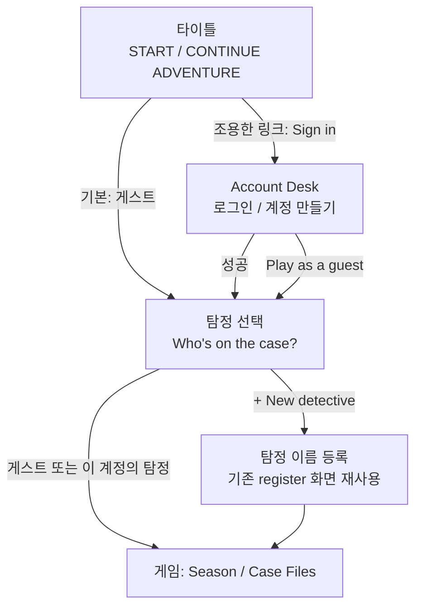

# Phase 3B — 계정 화면 구성안 (설계 · 구현 전)

> **상태:** 구현됨(커밋 전, 2026-10-13) — 화면 7종·라우트·PROD 가입 차단·DEV 전용 삭제 진입(비활성). 계정 삭제 서버 경로는 §6(미구현).
> **화면 언어:** 영어(게임 문체). `AuthFailure` 메시지도 영어로 바꿈.
> **계정 정책:** 일반 사용자 계정 + 탐정 프로필. 부모/자녀 계정 구분 없음. 게스트 플레이 유지.
> **원칙:** 로그인은 선택. 로그인 성공만으로 업로드하지 않음. 동의는 앱이 `confirmed`로 만들지 않음. 게스트 기록 보존. Victorian Detective Storybook 디자인 유지.

## 1. 흐름



- 앱 실행 시 로그인을 강요하지 않는다. 첫 실행은 지금처럼 START ADVENTURE → 게스트.
- 계정 진입에 Parent Gate를 거치지 않는다. Parent Gate·Parent Report는 지금 그대로(게임 기능).
- 로그인해도 게스트 프로필과 그 세이브는 그대로 남고 언제든 다시 고를 수 있다(`DetectiveProfile.mayOpen`).

## 2. 화면

| # | 화면 (경로 예) | 구성 | 재사용 |
|---|---|---|---|
| 1 | 타이틀 (`/`) | 기존 그대로 + 하단 조용한 잉크 링크 `Sign in` (로그인 시 `Signed in · Switch detective`) | `InkTextButton` |
| 2 | Account Desk (`/account`) | 서재 책상 배경 위 괘선 종이 한 장. 상단 잉크 탭 `SIGN IN` / `NEW ACCOUNT`. 이메일·비밀번호 괘선 입력, 비밀번호 보기 토글, 주 버튼 하나(`SIGN IN` / `CREATE ACCOUNT`), 링크 `Forgot password?`, `Play as a guest`. 오류는 종이 아래 try-again 잉크 한 줄 | `DeskBackground`, `PaperSheet(ruled)`, `GameButton`, `InkTextButton`, 기존 `AuthFailure` 메시지 |
| 3 | 비밀번호 재설정 | 같은 종이, 이메일 한 칸 + `SEND RESET LINK`. 결과 문구는 계정 유무와 무관하게 같음 | 위와 동일 |
| 4 | 이메일 확인 안내 | 봉인된 편지 카드 + `I'VE CHECKED MY EMAIL` / `Send again` | `LetterCard` 톤 |
| 5 | 탐정 선택 (`/profiles`) | 제목 `Who's on the case?`. 사건 파일 폴더 카드: 게스트(“This device”) + 이 계정의 탐정들. 카드 = 이름, 진행(해결한 Case 수), 마지막 플레이. `+ New detective` | `CaseFolder`, `PageHeading` |
| 6 | 계정 페이지 (`/account/me`) | 마스킹 이메일, `Cloud save: not available yet` (자물쇠 + 한 줄 설명), `Sign out`, `Change password` | `GameDialog.confirm`(로그아웃 확인) |

- 새 폰트·색 없음: 제목 IM Fell, 본문·버튼 Sentient, Navy/Gold/Ink 토큰만.
- 360×640, 글자 1.3배에서 키보드가 올라와도 주 버튼이 보이도록 종이 안 스크롤(`GameDialog.scrollable`과 같은 방식).
- 클라우드 저장 상태는 동의가 확인되기 전까지 항상 "아직 사용 불가"로만 표시(버튼 없음).

## 3. 하지 않는 것 (3B)

- 로그인 직후 업로드·동기화 없음(Phase 4).
- 동의 기록 쓰기·`confirmed` 전환 없음(신뢰 백엔드, `[LEGAL]`).
- 게스트 → 계정 데이터 이동 없음(Phase 4, 별도 확인 화면).
- 부모/자녀 계정 구분 없음.

## 4. 결정 필요 `[OPEN]` / `[LEGAL]`

| # | 항목 | 권장 / 메모 |
|---|---|---|
| B-1 `[LEGAL]` | **회원가입 자체가 개인정보(이메일) 수집** — 만 14세 미만이면 법정대리인 동의 필요 | 동의 절차 확정 전에는 가입 화면을 DEV/내부 빌드에만 두거나, 가입 전 연령 확인 단계를 둔다. 결정 전 운영 출시 금지 |
| B-2 | 계정 화면 언어 | 게임은 영어 UI, 계정 메시지는 현재 한국어(`AuthFailure`). 권장: 안내 문장은 한국어, 버튼은 기존 영어 버튼 스타일 |
| B-3 `[LEGAL]` | **앱 내 계정 삭제** | Google Play·App Store 모두 앱에서 계정을 만들면 앱 안 삭제 경로를 요구. 규칙은 삭제를 막아 두었으므로 삭제는 Cloud Functions(또는 Admin) 경로로 3B에 포함 권장 |
| B-4 | 이메일 인증을 로그인 조건으로 할지 | 권장: 로그인은 허용, 클라우드 기능은 인증 + 동의 확인 후 |
| B-5 | 타이틀의 `Sign in` 노출 위치 | 권장: 하단 조용한 링크(주 버튼은 게임 시작 하나 유지) |
| B-6 | Google/Apple 로그인 | 3B 범위 밖 권장(iOS에서 Google 제공 시 Apple 로그인 필수) |

## 5. 프로필 ID · 탐정 이름 호환 (3B 전 정리)

조사 결과와 제안은 `docs/PHASE3A_FIREBASE_AUTH_PLAN.md` §14 참고 (A1 + 정규형 이름 규칙).

## 6. 계정 삭제 — 서버 측 구조 제안 (구현 전)

### 6.1 현재 상태 (2026-10-13)

- 앱: DEV 빌드에만 `Delete account` 진입과 확인 화면이 있다. **삭제 버튼은 비활성**이고 "이 테스트 빌드에서는 아직 계정 삭제를 할 수 없습니다. 아무것도 삭제되지 않았습니다."를 표시한다. PROD에서는 진입 링크도 경로도 없다(`/account/delete` → 계정 페이지로 돌려보냄).
- `CloudEnvironment.accountDeletionAvailable`는 항상 `false`. 서버 경로가 생기기 전에는 켜지 않는다.
- 클라이언트만으로 Auth 사용자를 지우면 `users/{uid}`·프로필 문서가 남는다(규칙상 클라이언트 삭제 금지) → **하지 않는다**.

### 6.2 권장: Callable Cloud Function `deleteAccount`

```text
앱: 재인증(비밀번호) → deleteAccount() 호출 → 성공 시 로그아웃, 계정 탐정은 로컬에서 잠금 유지(또는 사용자 선택으로 로컬 삭제)
서버(Admin SDK, 2nd gen, asia-northeast3):
  1. context.auth 필수, auth_time이 최근 5분 이내인지 확인(아니면 'requires-recent-login')
  2. deletions/{uid} 작업 기록(상태: started) — 재시도 가능하게
  3. firestore.recursiveDelete(users/{uid})  ← 프로필·이후 게임 데이터까지
  4. consents/{uid}: 법정 보관 의무 확인 후 삭제 또는 최소 정보만 보관 [LEGAL]
  5. admin.auth().deleteUser(uid)
  6. deletions/{uid} 완료 표시(가명 정보: uid·시각·단계, 보관 기간 후 정리)
멱등: 중간 실패 시 같은 호출을 다시 하면 남은 단계만 진행. Auth 삭제는 마지막(문서가 남은 채 계정만 사라지는 일 방지).
```

- 대안: Firebase Extension "Delete User Data"(Auth 사용자 삭제 시 지정 경로 삭제). 클라이언트 `user.delete()` 후 서버가 정리하는 순서라, 정리 실패를 앱이 알기 어렵다 → 6.2를 권장.
- 규칙은 그대로(클라이언트 삭제 금지). Admin SDK는 규칙을 우회한다.

### 6.3 구현 가능 범위 확인

| 항목 | 상태 |
|---|---|
| Cloud Functions | **Blaze(종량제) 요금제 필요.** DEV에서 `firebase functions:list`가 실패 → 현재 Functions 미설정으로 보임. 요금제는 콘솔(사용량 및 결제)에서 사용자 확인 필요 |
| 배포 | Functions·규칙 배포는 별도 승인 필요(이번 단계 금지) |
| 에뮬레이터 | Functions + Firestore + Auth 에뮬레이터로 배포 없이 전 과정 테스트 가능(다음 단계 제안) |
| 법률 | 동의 기록 보관 기간, 삭제 요청 처리 기록 `[LEGAL]` |

> 참고: 확인 중 `firebase ext:list --project london-mystery-dev`가 DEV 프로젝트에 `firebaseextensions.googleapis.com` API를 자동으로 사용 설정했다(확장 설치 없음, 데이터 변경 없음). 필요하면 Google Cloud 콘솔 → API 및 서비스에서 사용 중지할 수 있다.

## 7. PROD 회원가입 차단 — 읽기 전용 확인 결과 (2026-10-13, 변경 없음)

| 항목 | `london-mystery-prod` |
|---|---|
| 이메일/비밀번호 제공자 | **사용 중** (`signIn.email.enabled = true`, 비밀번호 필수). 다른 로그인 제공자 없음, 익명 로그인 없음 |
| 가입 제한 설정 | `client.permissions` 비어 있음(= 가입 허용). Blocking Function 없음. 프로젝트 종류 `FIREBASE_AUTH`(Identity Platform 아님) |
| 운영 계정 수 | **0명** (`accounts:query`, 사용자 정보 없이 개수만) |
| 등록 앱 | Android `com.londonmystery.app` 1개, iOS `com.londonmystery.app` 1개(앱 미출시). 웹 앱 없음 |
| 다른 서비스 사용 흔적 | Hosting 기본 사이트만 있고 **배포 0회**, Remote Config 버전 0, Firestore `(default)`(서울) + 생성 시 규칙 1회. 사용 설정된 API는 새 프로젝트 기본 목록 수준 |
| 확인 방법 | Identity Toolkit·Service Usage·Firebase Management·Hosting·Rules·Remote Config의 **GET** 조회와 개수 조회만. API 사용 설정·설정 변경 없음 |

판단: 운영 사용자 0명, 웹/다른 클라이언트 없음, Hosting 미사용 → **제공자를 꺼도 기존 사용자·다른 서비스 영향 없음**(확인 가능한 범위에서). Google Cloud의 다른 비 Firebase 사용(예: 외부 서버가 이 프로젝트의 Auth를 호출)은 이 조회로 완전히 배제할 수 없다(API 호출 로그는 보지 않음).

### 7.1 비활성화 방법 (최종 승인 후 실행)

- **A. 이메일/비밀번호 제공자 끄기 (승인된 방향):** Firebase 콘솔 → `london-mystery-prod` → Authentication → 로그인 방법 → 이메일/비밀번호 → 사용 중지 → 저장.
  - 효과: 새 가입 **과 로그인 모두** 거부(`operation-not-allowed`). 현재 사용자 0명이라 영향 없음. 출시 후 동의 절차가 정해지면 다시 켠다.
  - 앱: PROD 화면은 이미 가입 탭이 없고, 로그인 시도는 "Something went wrong" 메시지가 된다 → 켜기 전까지 PROD에서 `Sign in` 링크 자체를 숨기는 작은 앱 수정 권장(별도 승인).
- **(참고) A'. 가입만 끄기:** 콘솔 Authentication → 설정 → 사용자 작업 → "생성(가입) 사용" 해제(`client.permissions.disabledUserSignup`). 로그인은 유지되고 가입만 막힌다. 이 프로젝트 종류에서 콘솔에 해당 항목이 보이는지 확인 필요. 보이면 A보다 영향이 작다.
- 되돌리기: 같은 화면에서 다시 사용 설정.
- 변경 후 확인(읽기 전용): `signIn.email.enabled`(A) 또는 `client.permissions.disabledUserSignup`(A') 값, 그리고 DEV는 그대로인지.

## 8. 계정 삭제 — 최소 구조 검토 (2026-10-13, 구현·배포 없음)

### 8.1 두 가지 길

| | S. 클라이언트 주도 (Spark 가능) | F. 서버 함수 (권장 장기안) |
|---|---|---|
| 요금제 | 현재 요금제 그대로 | **Blaze 필요**(Cloud Functions 배포) |
| Auth 삭제 | 앱이 `user.delete()` (최근 로그인 필요) | Admin `deleteUser(uid)` |
| Firestore 삭제 | 앱이 batch로 `users/{uid}/profiles/*` → `users/{uid}` 삭제. 규칙 변경 필요: 본인 + **최근 재인증**일 때만 delete 허용 | Admin `recursiveDelete(users/{uid})` (규칙 우회, 하위 게임 데이터 포함) |
| `consents/{uid}` | 클라이언트가 지울 수 없음 → **남는다**(보관 의무 여부 `[LEGAL]`) | 서버가 정책대로 삭제/최소 보관 |
| 재인증 | 앱: 비밀번호 재입력 → 5분 안에 진행. 규칙: `request.time - auth_time < 5분` | 앱 재인증 + 서버가 ID 토큰 `auth_time` 확인 |
| 부분 실패 | 순서: 문서 → Auth. 각 단계 멱등(없는 문서 삭제도 성공). 기기에 `삭제 진행 중(uid, 단계)` 표시를 남겨 다음 실행에서 이어 하기. Auth 삭제 실패 시 다시 재인증 후 재시도 | 서버 `deletions/{uid}` 기록으로 같은 호출 재시도 시 남은 단계만. Auth는 마지막 |
| 남는 위험 | 앱이 문서 삭제 후 Auth 삭제 전에 영영 실행되지 않으면 빈 Auth 계정이 남음(데이터는 없음). consents 잔존 | 함수 배포·운영 관리, 비용 알림 설정 필요 |

규칙 초안(S, 배포 안 함):

```
function recentlySignedIn() {
  return request.time.toMillis() - request.auth.token.auth_time * 1000 < 5 * 60 * 1000;
}
// users/{uid}:            allow delete: if isOwner(uid) && recentlySignedIn();
// users/{uid}/profiles/*: allow delete: if isOwner(uid) && recentlySignedIn();
// 동의 확인은 요구하지 않는다(삭제는 동의와 무관하게 늘 가능해야 함).
```

### 8.2 로컬 프로필 처리

- 게스트와 다른 계정의 탐정은 건드리지 않는다.
- 삭제한 계정의 탐정(`ownerUid == uid`)은 계정이 사라지면 다시 열 방법이 없다 → 확인 화면에서 "이 기기의 이 계정 탐정도 지우기"(기본 선택)를 보여 주고, **클라우드·Auth 삭제가 끝난 뒤** 해당 프로필의 레지스트리 항목과 네임스페이스 키(`lm.p.<id>.*`)를 지운다. 선택하지 않으면 잠긴 채 남는다.
- 필요한 새 코드: `ProfileStore.removeProfile(id)`(활성 프로필이면 먼저 게스트로 전환), 삭제 진행 표시 키 1개. 기존 저장 형식 변경 없음.

### 8.3 비용 (공식 요금표로 재확인 필요)

- 삭제 1건 = 문서 수(현재 users 1 + 프로필 n, Phase 4 이후 게임 데이터 포함)의 Firestore 삭제 + 함수 호출 1회(F).
- Firestore 무료 할당(일 2만 건 삭제)과 Functions 무료 할당(월 200만 호출) 안에서 이 규모의 앱은 사실상 0원 예상. 다만 **F는 Blaze 전환 자체가 결제 계정 연결**을 요구하므로 예산 알림 설정을 함께 권장.

### 8.4 제안 순서

1. 출시 전 계정 생성이 PROD에서 닫혀 있는 동안은 삭제 화면 비활성 유지(지금 상태).
2. PROD 가입을 여는 시점(동의 절차 확정)과 함께 F를 구현(Blaze 승인 시). Blaze를 쓰지 않기로 하면 S + consents 처리 방법을 법률 검토로 정한다.

### 8.5 dev-review 반영 (2026-10-13, `qitem-20261013133721`)

- **S의 한계(P2):** batch는 최대 500건 → 프로필 수 제한이 없으면 한 번에 못 지운다. 또 프로필 문서를 지워도 **하위 컬렉션(Phase 4 게임 데이터)은 남는다**, 규칙상 클라이언트는 그 경로를 지울 수도 없다. → S는 "현재 스키마(users + 프로필, 500건 단위로 나눠 삭제)"에서만 가능하고, 하위 게임 데이터가 생기는 Phase 4부터는 **F(서버 재귀 삭제)만** 허용한다.
- **F의 마지막 단계 공백(P2):** Auth 삭제는 성공했는데 `deletions/{uid}` 완료 기록이 실패하면, 사용자가 이미 없어 같은 호출로 재시도할 수 없다. → 오래된 `started` 기록을 찾아 마무리하는 예약 작업(또는 관리자 정리 절차)을 둔다. Auth 삭제는 계속 마지막. `deletions` 기록의 보관 기간도 정한다.
- **동의 기록(P2):** `consents/{uid}`는 법적 증거일 수 있다. 보관·삭제 정책이 문서로 정해지기 전에는 **계정 삭제를 계속 비활성**으로 둔다. 동의 기록을 보관하는 경우 삭제 화면 문구가 "모든 데이터를 지웠다"고 말하지 않게 한다(보관 항목과 기간을 안내).
- **PROD 차단(P2):** A는 서버 측에서 가입과 로그인을 함께 막는 올바른 조치이고, 운영 사용자 0명이라 영향은 확인한 범위에서 수용 가능하다. 단, **외부 서버가 이 프로젝트의 Auth를 호출하는지는 API 로그를 보지 않아 배제하지 못했다**(승인 기록에 남길 것). A'는 읽기 전용 확인으로 `disabledUserSignup`이 이 프로젝트에서 실제로 노출·적용되는 것이 확인될 때만 선택한다. A를 적용하면 PROD의 `Sign in` 링크도 숨긴다(별도 승인할 작은 앱 수정).
- **비용(P3):** §8.3은 추정이다. Blaze는 결제 계정 연결을 요구하고, 무료 호출 할당만으로 모든 런타임 비용이 0원임이 보장되지 않는다. 예산 알림과 출시 전 현재 요금 확인을 유지한다.
- 규칙 초안 확인: `auth_time`(초) × 1000과 `request.time.toMillis()`(밀리초)의 단위가 맞고, `isOwner(uid)`가 먼저 인증을 확인한다.

## 9. 계정 삭제 F안 — 서버 함수 구조 (2026-10-13, 로컬 코드·에뮬레이터 테스트만, 배포 없음)

결정: **F(서버 Cloud Functions)** 채택. 동의 기록 보관 정책이 정해질 때까지 앱의 삭제 기능은 **계속 비활성**(`CloudEnvironment.accountDeletionAvailable = false`).

### 9.1 파일

| 파일 | 내용 |
|---|---|
| `firebase/functions/deletion.js` | 핵심 로직(의존성 주입): `checkCaller`, `runDeletion`, `finishStaleDeletions` |
| `firebase/functions/index.js` | `deleteAccount`(onCall v2, 서울 리전), `finishStaleDeletions`(onSchedule 매시간). **배포 안 함** |
| `firebase/functions/test/deletion.test.js` | Firestore·Auth 에뮬레이터(demo 프로젝트) 13개 테스트. `cd firebase/functions && npm test` |

루트 `firebase.json`에는 일부러 `functions` 항목이 없다 → 저장소에서 `firebase deploy`를 해도 함수가 실수로 배포되지 않는다. 배포는 Blaze 승인 후 이 항목을 추가하는 별도 변경으로 한다.

### 9.2 순서와 실패 복구

```text
앱: 비밀번호 재입력(reauthenticate) → deleteAccount() 호출
서버 checkCaller: 로그인 필수, ID 토큰 auth_time이 5분 이내, 대상 uid = 호출자 자신(입력으로 uid를 받지 않음)
runDeletion(uid):
  1. deletions/{uid} = started (attempts +1, lastAttemptAt)        ← 추적 기록(가명 정보: uid + 시각·단계)
  2. recursiveDelete(users/{uid})  ← 프로필 + 하위 게임 데이터 전부(500건 제한 없음)
  3. consents/{uid}: 정책 'retain'(현재 기본) 또는 'delete'          ← 법률 결정 전 'retain'
  4. Auth 사용자 삭제(이미 없으면 통과)                                ← 항상 마지막
  5. deletions/{uid} = completed
실패 → 'started'로 남음 → 사용자가 다시 호출하면 남은 단계만(모두 멱등)
Auth 삭제 후 5단계 기록 실패 → 사용자는 더 호출할 수 없음 → finishStaleDeletions(15분 지난 started)가 마무리
```

- 추적 기록 `deletions/{uid}`는 규칙상 클라이언트 접근 불가(최하단 전부 거부), 서버(Admin)만 쓴다. 필드: status, step, attempts, startedAt, lastAttemptAt, completedAt, consentPolicy, consentRetained. 이메일·이름은 없지만 **uid가 지속 식별자이므로 가명 정보**다. 접근 권한(서버만)과 보관 기간 `[OPEN]`을 출시 전에 정한다(권장: 완료 후 일정 기간 뒤 삭제).
- 동의 정책은 삭제가 **시작될 때 기록된 값**을 끝까지 쓴다(사용자 재시도·정리 작업 모두). 기본값이 바뀌어도 진행 중인 삭제에는 적용되지 않는다.
- 정리 작업 쿼리는 `status == started` 하나만 써서 Firestore 자동 단일 필드 인덱스로 처리되고, 15분 경과 여부는 코드에서 비교한다 → **복합 인덱스 배포가 필요 없다**(dev-review P2 반영).
- 오류 응답: `unauthenticated`, `failed-precondition: requires-recent-login`, 그 밖은 `unavailable: try-again`(내부 정보 없음). 로그에 uid·이메일 없음.

### 9.3 앱 쪽 (삭제 기능을 켤 때 구현, 지금은 없음)

1. 확인 화면 → 비밀번호 재입력 → `deleteAccount` 호출(진행 중 표시, 버튼 잠금).
2. 성공: 로그아웃 → 확인 화면에서 고른 경우 이 계정의 로컬 탐정 삭제(`ProfileStore.removeProfile`, 게스트·다른 계정 무관). 동의 기록을 보관하면 "보관 항목·기간" 안내(“모두 삭제” 표현 금지).
3. 실패: 원인별 안내 + 다시 시도. `requires-recent-login`이면 비밀번호 재입력.
4. 켜는 조건(모두 충족 전에는 함수 미배포·앱 삭제 비활성 유지):
   - Blaze 승인과 DEV 선배포·검증
   - 동의 기록(`consents/{uid}`) 보관·삭제 정책 확정 `[LEGAL]`
   - **삭제 추적 기록(`deletions/{uid}`) 보관 기간 확정 + 완료 기록 자동 정리 구현**(예: 정리 작업이 기간이 지난 `completed` 기록 삭제, 테스트 포함) — dev-review 배포 전 조건
   - dev-review 재검토, DEV 실제 기기 검증

### 9.4 배포 조건과 예상 비용 (추정, 출시 전 공식 요금표 재확인)

| 항목 | 내용 |
|---|---|
| 요금제 | Cloud Functions 배포에 **Blaze(종량제) 필요** → 결제 계정 연결. 예산 알림 필수 설정 |
| 함수 호출 | 삭제 1건 = `deleteAccount` 1회. 예약 함수는 월 약 720회. 무료 할당(월 200만 호출) 안 |
| Firestore | 삭제 1건 = 문서 수만큼 삭제(현재 1 + 프로필 n, Phase 4 이후 게임 데이터 포함). 무료 할당(일 2만 건 삭제) 안 |
| 기타 | Cloud Scheduler(예약 함수) 작업 1개, Cloud Build·Artifact Registry(배포 시 이미지 저장) 소량 비용 가능. 무료 할당만으로 0원이 보장되지는 않음 |
| 배포 전 할 일 | DEV에 먼저 배포·검증, 리전 asia-northeast3 확인, 서비스 계정 권한 최소화, App Check 도입 검토 |
